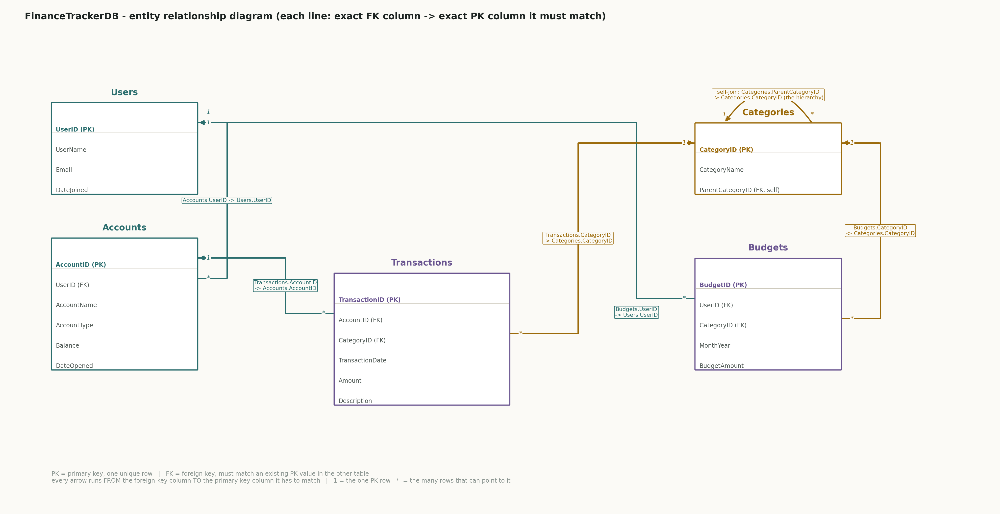
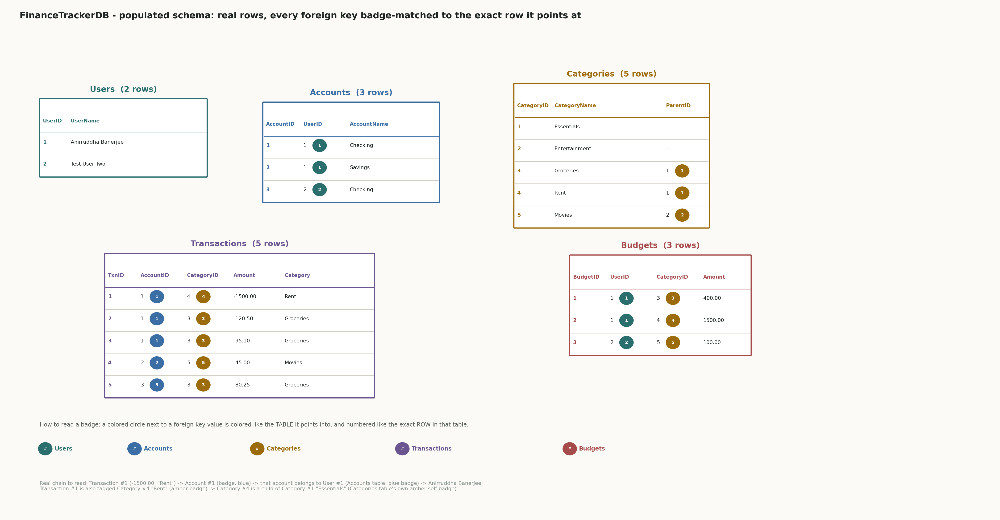

# Finance Tracker Build Notes — running log

Kept turn-by-turn as pieces are confirmed real (per spec's "Deliverables" section). Each entry: the real code, what it does, and the real output that confirmed it.

---

## Piece 0 — ER diagram (the blueprint)

Drawn before any `create table` statement, same as the spec's written schema table — but as the visual blueprint, which is the normal first step of designing a database: decide the shape and the relationships on paper (or in a diagram) first, write the DDL to match it second. The shape can still evolve as the build goes, but this is the agreed starting shape.



Five tables, three relationship "families":

- **Users → Accounts** and **Users → Budgets** (1-to-many, teal): one user owns many accounts and sets many budgets.
- **Accounts → Transactions** and **Categories → Transactions** (1-to-many): every transaction belongs to exactly one account and is tagged with exactly one category.
- **Categories → Budgets** (1-to-many, amber): a budget is set per category.
- **Categories self-join**: `ParentCategoryID → CategoryID` — a category can have a parent category (e.g. "Groceries" under "Essentials"), which is what makes the self-join and the recursive CTE later in the project meaningful rather than forced.

---

## Piece 1 — Database + Users table

**Why `Users` first:** every other table in this schema points *at* something — `Accounts` points at `Users`, `Transactions` points at `Accounts`/`Categories`, `Budgets` points at `Users`/`Categories`. A foreign key can't reference a table that doesn't exist yet, so the build order has to follow the dependency chain from the bottom up. `Users` has no foreign keys of its own, so it's the only table that can go first.

```sql
create database FinanceTrackerDB;
-- Commands completed successfully.

use FinanceTrackerDB;

create table Users (
    UserID     int identity(1,1) primary key,
    UserName   varchar(50) not null,
    Email      varchar(100) not null unique,
    DateJoined date not null default getdate()
);
-- Commands completed successfully.
```

Confirmed real: both statements returned "Commands completed successfully," no errors — expected and correct, per doc01's DDL-vs-DML point: `create database`/`create table` are DDL (defining structure), not DML (touching rows), so there's no "(N rows affected)" to print since no rows are involved yet.

Notes:
- `UserID` is `identity(1,1)` — SQL Server auto-assigns it, starting at 1, incrementing by 1.
- `Email` is marked `unique` on purpose — two users can share a name, but not an email, so this is a real constraint doing real work, not decoration.
- `DateJoined` defaults to `getdate()` on purpose too — so you don't have to supply it on every insert; SQL Server fills it in automatically if you leave it out.

---

## Piece 2 — Seed rows into Users

```sql
insert into Users (UserName, Email) values
    ('Anirruddha Banerjee', 'anirruddha@financetracker.test'),
    ('Test User Two', 'testuser2@financetracker.test');

select * from Users;
```

Confirmed real output:

```
UserID    UserName               Email                             DateJoined
------    --------               -----                             ----------
1         Anirruddha Banerjee    anirruddha@financetracker.test    2026-10-11
2         Test User Two          testuser2@financetracker.test     2026-10-11

(2 rows affected)
```

Notes:
- `UserID` and `DateJoined` were left out of the insert column list on purpose — `UserID` because `identity(1,1)` assigns it, `DateJoined` because the `default getdate()` fills it in.
- Real proof the defaults work: `UserID` came back 1, 2 (not specified, auto-assigned); `DateJoined` came back today's real date (2026-10-11), not something typed in.

---

## Piece 3 — Accounts table (with its foreign key)

```sql
create table Accounts (
    AccountID    int identity(1,1) primary key,
    UserID       int not null,
    AccountName  varchar(50) not null,
    AccountType  varchar(20) not null,
    Balance      decimal(10,2) not null default 0,
    DateOpened   date not null default getdate(),
    constraint FK_Accounts_Users foreign key (UserID) references Users(UserID)
);
```

Confirmed real: "Commands completed successfully."

Notes:
- This is the `Users -> Accounts` line from the ER diagram made real, and the whole point of including a `Users` table at all, per decision #2 in the spec: `constraint FK_Accounts_Users foreign key (UserID) references Users(UserID)` is what actually enforces that every account belongs to a real user — SQL Server will reject an insert that tries to use a `UserID` that doesn't exist in `Users`. So only UserID 1 or 2 (the two confirmed real users) can open an account right now.
- `FK_Accounts_Users` is just the constraint's own name (so it shows up by that name in error messages and in `sys.foreign_keys`), not a column.
- `Balance` defaults to `0` — a newly opened account starts at zero until funded, same pattern as `DateJoined`/`DateOpened` defaulting to today.

**Questions along the way:**

**Q:** "explain the meaning of this line, what is it doing and telling" — `constraint FK_Accounts_Users foreign key (UserID) references Users(UserID)`

**A:** It's a rule SQL Server enforces on every insert/update, not just a comment: every value written into `Accounts.UserID` has to already exist as a `UserID` in `Users`, or the row is rejected. Concretely, with the two real seeded users (UserID 1 and 2), an insert with `UserID = 1` succeeds, but `UserID = 99` fails outright, because there is no row in `Users` where `UserID = 99` — the table makes it structurally impossible to create an "orphan" account with no real owner, the same way a real bank never lets an account exist that isn't tied to a verified customer record. Breaking the line down: `constraint FK_Accounts_Users` just names the rule (shows up under that name in error messages and in `sys.foreign_keys` — not a column); `foreign key (UserID)` says which column in *this* table (`Accounts`) is being restricted; `references Users(UserID)` says which table+column it has to match — the primary key of `Users`. This is called *referential integrity*, and it's enforced by the engine itself, so no application bug can sneak in a bad reference. One side effect worth remembering for later: SQL Server will also refuse to delete a `Users` row while any `Accounts` row still points at it, since deleting it would break this same rule.

---

## Piece 4 — Seed rows into Accounts

Once seeded, we have real `AccountID`s to attach transactions to:

```sql
insert into Accounts (UserID, AccountName, AccountType) values
    (1, 'Checking', 'Checking'),
    (1, 'Savings', 'Savings'),
    (2, 'Checking', 'Checking');

select * from Accounts;
```

Confirmed real output:

```
AccountID   UserID   AccountName    AccountType   Balance  DateOpened
---------   ------   -----------    -----------   -------  ----------
1           1        Checking       Checking      0.00     2026-10-11
2           1        Savings        Savings       0.00     2026-10-11
3           2        Checking       Checking      0.00     2026-10-11

(3 rows affected)
```

Notes:
- `AccountID` and `Balance`/`DateOpened` were left out of the insert column list, same reasoning as before — `AccountID` is `identity(1,1)`, `Balance` and `DateOpened` fall back to their `default` values.
- Real proof: `AccountID` came back 1, 2, 3 (auto-assigned, continuing from 1); `Balance` came back `0.00` for all three (the `default 0`, not something typed in); `DateOpened` came back today's real date.
- The `UserID` column proves the foreign key from Piece 3 is actually doing something: rows 1 and 2 (`UserID = 1`) and row 3 (`UserID = 2`) all matched real rows in `Users` — this insert would have been rejected outright if any `UserID` here didn't already exist in `Users`.

---

## Piece 5 — Categories table (self-referencing)

This is the self-referencing table from the ER diagram (`ParentCategoryID -> CategoryID`), and it needs to exist before `Transactions`, since `Transactions` will have a foreign key into it:

```sql
create table Categories (
    CategoryID       int identity(1,1) primary key,
    CategoryName     varchar(50) not null,
    ParentCategoryID int null,
    constraint FK_Categories_Parent foreign key (ParentCategoryID) references Categories(CategoryID)
);
```

Confirmed real: "Commands completed successfully."

Notes:
- `ParentCategoryID` is `int null` (not `not null`) on purpose — a top-level category like "Essentials" has no parent, so that column has to be allowed to be empty.
- The foreign key references `Categories(CategoryID)` — this table's own primary key — which is what makes it self-referencing: every `ParentCategoryID`, when it's not null, has to point at a real `CategoryID` that already exists in this same table.

Questions along the way: none — understood on the first pass.

---

## Piece 6 — Seed top-level categories

This has to happen in two steps, not one: the top-level categories (no parent) need to exist and get their real, auto-assigned `CategoryID`s first, before any child category can reference a real parent ID — same reasoning as `Accounts` needing real `Users` rows to reference before it could be seeded.

```sql
insert into Categories (CategoryName, ParentCategoryID) values
    ('Essentials', NULL),
    ('Entertainment', NULL);

select * from Categories;
```

Confirmed real output:

```
CategoryID  CategoryName    ParentCategoryID
----------  ------------    ----------------
1           Essentials      NULL
2           Entertainment   NULL

(2 rows affected)
```

Notes:
- `ParentCategoryID` was passed as `NULL` explicitly — these two have no parent, by definition, since they're the top of the hierarchy.
- Real proof: `CategoryID` came back 1 and 2 (auto-assigned by `identity(1,1)`), and `ParentCategoryID` genuinely came back `NULL` for both — not rejected, because the column was defined `int null` (nullable) in Piece 5 specifically to allow this.
- These two real IDs (`Essentials` = 1, `Entertainment` = 2) are what the next piece's child categories will actually reference — not guessed numbers.

Questions along the way: none — understood on the first pass.

---

## Piece 7 — Seed child categories under their real parents

Now that `Essentials` (CategoryID 1) and `Entertainment` (CategoryID 2) are real rows, child categories can reference them for real — this is the self-referencing foreign key from Piece 5 actually getting used for the first time:

```sql
insert into Categories (CategoryName, ParentCategoryID) values
    ('Groceries', 1),
    ('Rent', 1),
    ('Movies', 2);

select * from Categories;
```

Confirmed real output:

```
CategoryID  CategoryName       ParentCategoryID
----------  ------------       ----------------
1           Essentials         NULL
2           Entertainment      NULL
3           Groceries          1
4           Rent               1
5           Movies             2

(5 rows affected)
```

Notes:
- `Groceries` and `Rent` got `ParentCategoryID = 1` (under `Essentials`), `Movies` got `ParentCategoryID = 2` (under `Entertainment`) — each matched a real `CategoryID` already in the table, which is exactly what `FK_Categories_Parent` enforces; any of these would have been rejected if it pointed at a `CategoryID` that didn't exist.
- `Categories` now holds the real two-level hierarchy (`Essentials`/`Entertainment` as parents, `Groceries`/`Rent`/`Movies` as children) that the self-join and the recursive CTE later in the project will actually walk — not placeholder data invented just to fill a box.

Questions along the way: none — understood on the first pass.

---

## Piece 8 — Transactions table (two foreign keys at once)

With `Accounts` (Piece 3/4) and `Categories` (Piece 5/6/7) both holding real rows now, `Transactions` can finally be built — it's the table with two foreign keys at once, one into each:

```sql
create table Transactions (
    TransactionID   int identity(1,1) primary key,
    AccountID       int not null,
    CategoryID      int not null,
    TransactionDate date not null,
    Amount          decimal(10,2) not null,
    Description     varchar(200) null,
    constraint FK_Transactions_Accounts foreign key (AccountID) references Accounts(AccountID),
    constraint FK_Transactions_Categories foreign key (CategoryID) references Categories(CategoryID)
);
```

Confirmed real: "Commands completed successfully."

Notes:
- `AccountID` and `CategoryID` are both `not null` here — unlike `Categories.ParentCategoryID`, a transaction is never allowed to exist without a real account it happened in and a real category it belongs to, so there's no nullable escape hatch on either one.
- Two separate `constraint ... foreign key` clauses are used (not one combined line) because these are two independent rules checked against two different tables — `AccountID` against `Accounts`, `CategoryID` against `Categories` — and SQL Server needs each one named and declared on its own.

Questions along the way: none — understood on the first pass.

---

## Piece 9 — Seed real transactions

With both foreign keys enforced, every transaction inserted now has to point at a real account and a real category — this is the first piece that actually puts money through the schema, spread across accounts and categories so later pieces (running balance over time, month-over-month spending per category) have something real to work with:

```sql
insert into Transactions (AccountID, CategoryID, TransactionDate, Amount, Description) values
    (1, 4, '2026-09-01', -1500.00, 'September rent'),
    (1, 3, '2026-09-05', -120.50, 'Weekly groceries'),
    (1, 3, '2026-09-19', -95.10, 'Groceries top-up'),
    (2, 5, '2026-09-10', -45.00, 'Movie night'),
    (3, 3, '2026-09-12', -80.25, 'Groceries');

select * from Transactions;
```

Confirmed real output:

```
TransactionID  AccountID  CategoryID  TransactionDate  Amount    Description
-------------  ---------  ----------  ---------------  ------    -----------
1              1          4           2026-09-01       -1500.00  September rent
2              1          3           2026-09-05       -120.50   Weekly groceries
3              1          3           2026-09-19       -95.10    Groceries top-up
4              2          5           2026-09-10       -45.00    Movie night
5              3          3           2026-09-12       -80.25    Groceries

(5 rows affected)
```

Notes:
- `Amount` is negative for all of these on purpose — these are money leaving the account (spending), so a negative number is the honest representation; a future deposit/income transaction would be the positive case.
- `AccountID`/`CategoryID` values were picked to match real rows already confirmed in Pieces 4 and 6/7, not arbitrary numbers — real proof: all 5 rows inserted clean, which they wouldn't have if any `AccountID` or `CategoryID` pointed at something that didn't exist in `Accounts`/`Categories`.
- Caught and fixed one mistake before this ran: the September rent row was first drafted with `CategoryID = 3` (`Groceries`) instead of `4` (`Rent`) — fixed in chat before you typed it, so the real data came out correct on the first real run.

Questions along the way: none — understood on the first pass.

---

## Piece 10 — Budgets table (last of the five)

The last of the five tables from the ER diagram — `Budgets` has two foreign keys, both into tables that already hold real rows (`Users` and `Categories`):

```sql
create table Budgets (
    BudgetID      int identity(1,1) primary key,
    UserID        int not null,
    CategoryID    int not null,
    MonthYear     date not null,
    BudgetAmount  decimal(10,2) not null,
    constraint FK_Budgets_Users foreign key (UserID) references Users(UserID),
    constraint FK_Budgets_Categories foreign key (CategoryID) references Categories(CategoryID)
);
```

Confirmed real: "Commands completed successfully."

Notes:
- `MonthYear` is a `date` column even though a budget is really set per *month*, not per specific day — the convention (used consistently once real rows go in) will be to always store the 1st of the month, e.g. `2026-09-01` for the September budget, so `month(MonthYear)`/`year(MonthYear)` style queries later have something clean to group on.
- With this table created, all five tables from the ER diagram now exist for real: `Users`, `Accounts`, `Categories`, `Transactions`, `Budgets`.

Questions along the way: none — understood on the first pass.

---

## Piece 11 — Seed real budgets (last seed piece)

This is the last seed piece — once this runs, every table in the schema has real rows, and the full populated-schema diagram (showing every table's real data with foreign keys traced row-to-row) can be built:

```sql
insert into Budgets (UserID, CategoryID, MonthYear, BudgetAmount) values
    (1, 3, '2026-09-01', 400.00),
    (1, 4, '2026-09-01', 1500.00),
    (2, 5, '2026-09-01', 100.00);

select * from Budgets;
```

Confirmed real output:

```
BudgetID  UserID  CategoryID  MonthYear   BudgetAmount
--------  ------  ----------  ---------   ------------
1         1       3           2026-09-01  400.00
2         1       4           2026-09-01  1500.00
3         2       5           2026-09-01  100.00

(3 rows affected)
```

Notes:
- These set a September 2026 budget for user 1 (Anirruddha) on `Groceries` (CategoryID 3) and `Rent` (CategoryID 4), and for user 2 (Test User Two) on `Movies` (CategoryID 5) — real `UserID`/`CategoryID` values matching rows already confirmed, and the same September month the real `Transactions` rows from Piece 9 fall in, so a budget-vs-actual-spend comparison later has real matching data on both sides.
- Real proof: all 3 rows inserted clean, `BudgetID` auto-assigned 1-3 — which wouldn't have happened if any `UserID`/`CategoryID` here didn't already exist in `Users`/`Categories`.
- With this, every table in the schema now holds real seeded data: `Users` (2 rows), `Accounts` (3 rows), `Categories` (5 rows), `Transactions` (5 rows), `Budgets` (3 rows).

Questions along the way: none — understood on the first pass.

---

## Populated Schema — every table's real data, every foreign key traced to its exact row

All five tables now hold real data from Pieces 1-11. This section lays out every real row, table by table, and for every foreign key column, resolves it to the exact row it points at (not just "Accounts.UserID -> Users.UserID" in the abstract, but which specific user). A matching companion diagram (`finance_tracker_db/diagrams/populated_schema.png`) gives the same thing as a picture, using a colored badge per table instead of drawn lines between ~22 individual rows (which would be unreadable at this scale) — color + number on an FK value tells you exactly which row it resolves to.



### Users (2 rows) — referenced by Accounts.UserID, Budgets.UserID

| UserID (PK) | UserName | Email | DateJoined |
|---|---|---|---|
| 1 | Anirruddha Banerjee | anirruddha@financetracker.test | 2026-10-11 |
| 2 | Test User Two | testuser2@financetracker.test | 2026-10-11 |

### Accounts (3 rows) — UserID -> Users.UserID; referenced by Transactions.AccountID

| AccountID (PK) | UserID (FK) | AccountName | AccountType | Balance | DateOpened | UserID resolves to |
|---|---|---|---|---|---|---|
| 1 | 1 | Checking | Checking | 0.00 | 2026-10-11 | Users #1 - Anirruddha Banerjee |
| 2 | 1 | Savings | Savings | 0.00 | 2026-10-11 | Users #1 - Anirruddha Banerjee |
| 3 | 2 | Checking | Checking | 0.00 | 2026-10-11 | Users #2 - Test User Two |

### Categories (5 rows) — ParentCategoryID -> Categories.CategoryID (self); referenced by Transactions.CategoryID, Budgets.CategoryID

| CategoryID (PK) | CategoryName | ParentCategoryID (FK) | ParentCategoryID resolves to |
|---|---|---|---|
| 1 | Essentials | NULL | (top-level, no parent) |
| 2 | Entertainment | NULL | (top-level, no parent) |
| 3 | Groceries | 1 | Categories #1 - Essentials |
| 4 | Rent | 1 | Categories #1 - Essentials |
| 5 | Movies | 2 | Categories #2 - Entertainment |

### Transactions (5 rows) — AccountID -> Accounts.AccountID; CategoryID -> Categories.CategoryID

| TransactionID (PK) | AccountID (FK) | CategoryID (FK) | TransactionDate | Amount | Description | AccountID resolves to | CategoryID resolves to |
|---|---|---|---|---|---|---|---|
| 1 | 1 | 4 | 2026-09-01 | -1500.00 | September rent | Accounts #1 - Checking (User 1) | Categories #4 - Rent |
| 2 | 1 | 3 | 2026-09-05 | -120.50 | Weekly groceries | Accounts #1 - Checking (User 1) | Categories #3 - Groceries |
| 3 | 1 | 3 | 2026-09-19 | -95.10 | Groceries top-up | Accounts #1 - Checking (User 1) | Categories #3 - Groceries |
| 4 | 2 | 5 | 2026-09-10 | -45.00 | Movie night | Accounts #2 - Savings (User 1) | Categories #5 - Movies |
| 5 | 3 | 3 | 2026-09-12 | -80.25 | Groceries | Accounts #3 - Checking (User 2) | Categories #3 - Groceries |

### Budgets (3 rows) — UserID -> Users.UserID; CategoryID -> Categories.CategoryID

| BudgetID (PK) | UserID (FK) | CategoryID (FK) | MonthYear | BudgetAmount | UserID resolves to | CategoryID resolves to |
|---|---|---|---|---|---|---|
| 1 | 1 | 3 | 2026-09-01 | 400.00 | Users #1 - Anirruddha Banerjee | Categories #3 - Groceries |
| 2 | 1 | 4 | 2026-09-01 | 1500.00 | Users #1 - Anirruddha Banerjee | Categories #4 - Rent |
| 3 | 2 | 5 | 2026-09-01 | 100.00 | Users #2 - Test User Two | Categories #5 - Movies |

**Reading it end to end, one real chain:** Transaction #1 (-1500.00, "September rent") belongs to Account #1 ("Checking"), which belongs to User #1 (Anirruddha Banerjee), and is tagged with Category #4 ("Rent"), which is a child of Category #1 ("Essentials"). Budget #2 sets a 1500.00 September budget for that same User #1 on that same Category #4 — so this transaction is exactly the kind of real spending that budget was meant to track, traceable purely through the foreign keys above, not by assumption.

---

Schema and seed data are both done now — every table in the spec's five has real rows (Piece 11 finished the last of them, Budgets). The spec's "Required coverage" checklist is what's next, and the first item on it is joins: inner, left, right, full outer, and a self-join on Categories. Starting with inner join because every other join type is really "inner join, plus a rule for what to do with the rows that don't match" — so inner join is the baseline the rest build on.

