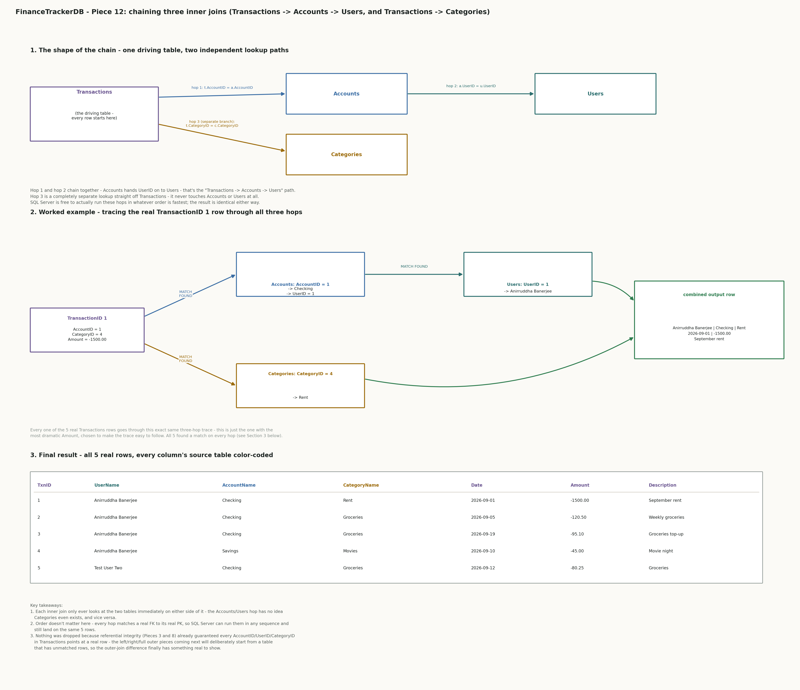

## Piece 12 — inner join (Transactions + Accounts + Users + Categories)

```sql
select
    t.TransactionID,
    u.UserName,
    a.AccountName,
    c.CategoryName,
    t.TransactionDate,
    t.Amount,
    t.Description
from Transactions t
inner join Accounts a on t.AccountID = a.AccountID
inner join Users u on a.UserID = u.UserID
inner join Categories c on t.CategoryID = c.CategoryID
order by t.TransactionID;
```

Confirmed real output:

```
TransactionID  UserName             AccountName  CategoryName  TransactionDate  Amount    Description
-------------  --------             -----------  ------------  ---------------  ------    -----------
1              Anirruddha Banerjee  Checking     Rent          2026-09-01       -1500.00  September rent
2              Anirruddha Banerjee  Checking     Groceries     2026-09-05       -120.50   Weekly groceries
3              Anirruddha Banerjee  Checking     Groceries     2026-09-19       -95.10    Groceries top-up
4              Anirruddha Banerjee  Savings      Movies        2026-09-10       -45.00    Movie night
5              Test User Two        Checking     Groceries     2026-09-12       -80.25    Groceries

(5 rows affected)
```

Notes:
- This query turns the raw IDs sitting in `Transactions` into something a person could actually read — the real user's name, the real account name, the real category name — by inner-joining across all four tables that a transaction touches. Real proof: TransactionID 1 came back as "Anirruddha Banerjee / Checking / Rent," not as AccountID 1 / CategoryID 4.
- `inner join` only keeps a row when both sides have a match. That match was guaranteed in advance here — every `Transactions.AccountID` and `Transactions.CategoryID` was already forced to point at a real row when the foreign keys were created (Piece 8), and every `Accounts.UserID` was forced to point at a real `Users` row (Piece 3) — so this query couldn't drop any of the 5 real `Transactions` rows, and real proof it didn't: all 5 came back.
- That's the point worth noticing: inner join's "drop what doesn't match" behavior is invisible here because the schema's own foreign keys already prevented orphans from existing. The difference between inner and outer joins will show up for real in the next few pieces, once the join starts *from* a table that has rows nothing points at yet — `Categories` already has two of those (CategoryID 1 "Essentials" and 2 "Entertainment" are parent categories that no `Transactions` row is tagged with directly, only their children are).
- Three joins chained (`Transactions -> Accounts -> Users`, and `Transactions -> Categories`) is normal — each `inner join` only needs to know the two tables immediately on either side of it, not the whole chain at once.
- **What this is really answering (interview-style scenario):** the shape of question this query answers is "given Transactions, Accounts, Users, and Categories, show every transaction in human-readable form — who made it, which account, which category." That's a classic "join the raw IDs back into readable info" interview prompt, and in a real finance app it's literally the query that would power a transaction-history screen.
- **Visual representation:** since this is the first query in the project chaining more than two tables, a companion diagram below walks through how the chain actually works — the two lookup paths off `Transactions` (one hopping twice through `Accounts` to `Users`, one straight to `Categories`), a worked trace of the real TransactionID 1 row through all three hops, and the final 5-row result with every column's source table color-coded.



**Questions along the way:**

Q: Why did we do an inner join here? What's the necessity of it in this project? What are we trying to show/do with this join? Will it be used later? Why not the other join types, only inner join?

A: Necessity first: the spec's "Required coverage" checklist (the pass/fail bar for the whole project) literally lists "every join type - inner, left, right, full outer, and a self-join" as one line item, so some inner join query was always going to exist here regardless of which one came first. Inner join specifically comes first because it's the baseline every other join type is built from - `left join` is "inner join, plus also keep the unmatched rows from the left table, NULL-filled"; `right join` and `full outer join` are the same idea from the other side(s). You can't really understand what those *add* until you've seen the plain match-only version they're extending.

What this particular query is showing: the whole reason this project's schema is split into five separate tables (Piece 0's ER diagram, Pieces 1-11 building each one) is normalization - `Transactions` doesn't repeat the user's name or the account's name on every row, it just stores `AccountID` and `CategoryID` numbers and trusts the foreign keys to keep those numbers honest. That's great for storage and integrity, but nobody wants to read a transaction list that says "AccountID 1, CategoryID 4, -1500.00" - a human (or a report, or an app screen) wants "Checking, Rent, -1500.00". A join is the mechanism SQL gives you to reassemble that normalized data back into something readable, on demand, without ever storing a duplicate copy of "Checking" or "Rent" anywhere. That's literally what Piece 12 demonstrates.

Will it be used later: yes, constantly - this is not a one-off demo. Almost every query from here on that needs to show readable output instead of raw IDs will lean on the same inner-join pattern, including the budget-vs-actual-spend comparison already flagged at the end of the Populated Schema section (Budget #2 vs Transaction #1), the running-balance window-function piece, and the views/stored-procedure pieces later in the spec. Piece 12 is the join pattern most of the rest of the project reuses, not an isolated exercise.

Why only inner join here, not the others yet: left/right/full outer joins only prove something *different* from inner join when a row on one side has no match on the other side - otherwise they return the exact same rows inner join does, which wouldn't demonstrate anything new. Right now, in this real seeded data, `Accounts` and `Users` don't have that case - every account belongs to a real user, every account has at least one transaction (Piece 12's own Notes already point this out). The one place that case genuinely exists right now is `Categories` - CategoryID 1 ("Essentials") and 2 ("Entertainment") are parent categories with no `Transactions` row tagged to them directly, only their children are. So inner join went first because it's the type that has something clean to show on this exact data as-is; left/right/full outer are next specifically because they'll deliberately join from `Categories`, where there's finally an unmatched row for them to prove their point with.

---

Piece 12 proved inner join's blind spot: it can only show rows that match on both sides, and every row in this project's current data already had a guaranteed match, so nothing ever got dropped to prove the point. Left join fixes that by keeping a left-side row even when nothing on the right matches it, filling the right side's columns with NULL instead of dropping the row - and this project already has a real place to see that happen: `Categories` has two rows (CategoryID 1 "Essentials" and 2 "Entertainment") that no `Transactions` row is tagged to directly, only their children are. Joining from `Categories` this time, instead of from `Transactions`, is what makes left join's extra behavior show up in real output instead of staying theoretical.

## Piece 13 — left join (Categories + Transactions)

```sql
select
    c.CategoryID,
    c.CategoryName,
    t.TransactionID,
    t.Amount,
    t.Description
from Categories c
left join Transactions t on c.CategoryID = t.CategoryID
order by c.CategoryID, t.TransactionID;
```

Confirmed real output:

```
CategoryID  CategoryName   TransactionID  Amount    Description
----------  ------------   -------------  ------    -----------
1           Essentials     NULL           NULL      NULL
2           Entertainment  NULL           NULL      NULL
3           Groceries      2              -120.50   Weekly groceries
3           Groceries      3              -95.10    Groceries top-up
3           Groceries      5              -80.25    Groceries
4           Rent           1              -1500.00  September rent
5           Movies         4              -45.00    Movie night

(7 rows affected)
```

Notes:
- **What we did and what it shows:** every `Categories` row is kept this time, even the two with nothing matching on the right. Real proof: 7 rows came back, not 5 — `Categories` only has 5 rows total, so the extra 2 are CategoryID 1 ("Essentials") and 2 ("Entertainment") showing up with `TransactionID`, `Amount`, and `Description` all printed as `NULL`, exactly the two rows Piece 12's own notes predicted would be the first place an outer join could show something real.
- **Why it's `NULL` and not blank or an error:** SQL Server has no `Transactions` row to pull those three columns from for CategoryID 1 or 2, so it fills the gap with `NULL` rather than dropping the row (what `inner join` would have done) or refusing to run. `NULL` here means "no matching row existed," not "the data is missing or wrong."
- **Direct comparison to Piece 12:** same two tables' worth of information, two different join types, two different row counts on the exact same real data — inner join (joining from `Transactions`) returned 5; left join (joining from `Categories`) returns 7. That 2-row difference *is* the entire concept of outer joins, made concrete instead of abstract.
- **What this is really answering (interview-style scenario):** given `Categories` and `Transactions`, "find every category that has never been used in a transaction" or "list every category along with its spending, including categories with zero spending so far" is a classic interview question shape — the "find the ones with none" pattern (same shape as "find customers who never placed an order"). Left join is the standard tool for it, specifically *because* inner join would silently hide the very rows the question is asking about.

Questions along the way: none — understood on the first pass.

---

Piece 13 showed left join by keeping every `Categories` row and padding the missing `Transactions` side with `NULL`. Right join does the exact same thing, just with which side gets kept flipped — it's not a separate concept to learn, it's the same mechanism written from the other direction. The cleanest way to prove that isn't with new data, it's by writing the *same real result* from Piece 13 a different way: start the query from `Transactions` instead of `Categories`, and use `right join` to say "but still keep every row from `Categories`, even unmatched ones."

## Piece 14 — right join (Transactions + Categories)

```sql
select
    c.CategoryID,
    c.CategoryName,
    t.TransactionID,
    t.Amount,
    t.Description
from Transactions t
right join Categories c on t.CategoryID = c.CategoryID
order by c.CategoryID, t.TransactionID;
```

Confirmed real output:

```
CategoryID  CategoryName   TransactionID  Amount    Description
----------  ------------   -------------  ------    -----------
1           Essentials     NULL           NULL      NULL
2           Entertainment  NULL           NULL      NULL
3           Groceries      2              -120.50   Weekly groceries
3           Groceries      3              -95.10    Groceries top-up
3           Groceries      5              -80.25    Groceries
4           Rent           1              -1500.00  September rent
5           Movies         4              -45.00    Movie night

(7 rows affected)
```

Notes:
- **What we did and what it shows:** real proof the prediction held — this came back byte-for-byte the same 7 rows as Piece 13's left join, same two NULL-padded rows for Essentials and Entertainment. The only thing that changed between the two queries is which table is named in `from` versus which is named in the join, and which join keyword is used; the result is identical because both queries are asking the same underlying question, just naming the tables in the opposite order.
- **Why they're the same:** `right join` keeps every row from the table on the *right* of the join keyword, padding the left side with `NULL` where nothing matches — here that's `Categories c`, same table Piece 13 kept by naming it first and using `left join`. `A left join B` and `B right join A` always produce the same rows for that reason; right join isn't a different operation, it's left join with the roles of the two tables swapped in the sentence.
- **Real-world note:** a lot of style guides and working SQL developers avoid `right join` entirely and just rewrite everything as `left join` (reordering the `from`/`join` tables if needed), purely for consistency — one join direction to read instead of two. That convention is *why* interviewers like asking you to convert between them: it checks whether you understand the equivalence, not just whether you can type the keyword.
- **What this is really answering (interview-style scenario):** a very common interview ask is "rewrite this left join as a right join" or "what's the difference between left and right join" — and the honest technical answer, provable right here with real output, is "nothing, if you also swap which table is named where." This piece exists specifically to make that provable rather than just stated.

Questions along the way: none — understood on the first pass.

---

Piece 13 and 14 both showed a one-sided unmatched row - `Categories` had parents with no transactions, but the "many" side (`Transactions`, `Accounts`) can never be unmatched, because its foreign keys force every row to point at something real. Full outer join only earns its keep when *both* sides can genuinely have unmatched rows, and nowhere in this schema's declared foreign keys does that happen - so this piece deliberately joins two tables that have no foreign key between them at all: `Budgets` and `Transactions`, matched by `(UserID, CategoryID)` instead of a declared FK (bridging `Transactions` to a `UserID` through `Accounts` first, since `Transactions` only stores `AccountID` directly). This is also the exact comparison the Populated Schema section flagged back at the end of Piece 11 - "Budget #2 vs Transaction #1" - done properly this time: every budget alongside its real spending, any budget with zero spending yet, and any spending that has no budget set for it, all in one real result.

## Piece 15 — full outer join (Budgets + Transactions, matched by UserID + CategoryID)

```sql
select
    b.BudgetID,
    b.UserID,
    b.CategoryID,
    b.BudgetAmount,
    t.TransactionID,
    t.Amount,
    t.Description
from Budgets b
full outer join (
    select tr.TransactionID, a.UserID, tr.CategoryID, tr.Amount, tr.Description
    from Transactions tr
    inner join Accounts a on tr.AccountID = a.AccountID
) t
    on b.UserID = t.UserID and b.CategoryID = t.CategoryID
order by b.BudgetID, t.TransactionID;
```

Confirmed real output:

```
-- intermediate check: the derived table alone (UserID bridged in via Accounts)
TransactionID  UserID  CategoryID  Amount    Description
-------------  ------  ----------  ------    -----------
1              1       4           -1500.00  September rent
2              1       3           -120.50   Weekly groceries
3              1       3           -95.10    Groceries top-up
4              1       5           -45.00    Movie night
5              2       3           -80.25    Groceries

(5 rows affected)

-- final result: full outer join against Budgets
BudgetID  UserID  CategoryID  BudgetAmount  TransactionID  Amount    Description
--------  ------  ----------  ------------  -------------  ------    -----------
NULL      NULL    NULL        NULL          4              -45.00    Movie night
NULL      NULL    NULL        NULL          5              -80.25    Groceries
1         1       3           400.00        2              -120.50   Weekly groceries
1         1       3           400.00        3              -95.10    Groceries top-up
2         1       4           1500.00       1              -1500.00  September rent
3         2       5           100.00        NULL           NULL      NULL

(6 rows affected)
```

Notes:
- **What the query is doing, step by step:** the inner part — `select tr.TransactionID, a.UserID, tr.CategoryID, tr.Amount, tr.Description from Transactions tr inner join Accounts a on tr.AccountID = a.AccountID` — runs first, entirely on its own, and doesn't touch `Budgets` at all. It reuses the same "hop through `Accounts` to find `UserID`" move from Piece 12 to build a temporary result set: every transaction, now carrying its owner's `UserID` alongside it. That bridge is necessary because `Budgets` stores `UserID` directly but `Transactions` never does — there's no shared column to join on until this exists. The "intermediate check" block above confirms that bridge in isolation: the same 5 transactions as always, now with a real `UserID` column added. The outer part then treats that whole result as a stand-in table, aliased `t`, and does `Budgets b full outer join (...) t on b.UserID = t.UserID and b.CategoryID = t.CategoryID` — matching on *both* columns together, since a budget belongs to one specific user and one specific category, so a transaction only "counts against" it when both line up.
- **What kind of subquery this is, and how it relates to `01 sql fundamentals.md`:** that doc's §5 "Subqueries" covers three shapes — a *scalar* subquery (returns one value, used in a comparison like `where Amount > (select avg(Amount)...)`), an *IN* subquery (returns a list, used in `where X in (subquery)`), and a *correlated* subquery (re-runs once per outer row, referencing an outer column). This piece uses a fourth shape that doc didn't name: a **derived table** (also called an inline view) — a subquery that returns full rows and columns and gets used in the `FROM` clause as if it were its own temporary table. `full outer join` needs two real row-sets with columns to match against, not a single value or a list, which is why this shape was the one that fit here.
- **Honest note on a cleaner alternative:** `05 sql ctes.md` is still ahead of us on the Required Coverage checklist, and a CTE (`with t as (...)`) would have been the more-readable way to write this exact same subquery — the logic is identical, only the syntax changes. The derived-table form was used here on purpose, so `full outer join` stayed the one new concept in this piece instead of two at once. This query is a strong candidate to revisit and rewrite as a CTE once that piece comes up, to show the same logic both ways side by side.
- **Real proof the join worked both directions:** 6 rows came back, more than either table alone (`Budgets` has 3, the derived transaction set has 5) — because 2 transactions (Movie night, Groceries for User 2) matched nothing in `Budgets` and show up with the budget columns `NULL`, while 1 budget (BudgetID 3, User 2's Movies budget) matched no transaction and shows up with the transaction columns `NULL`. The other 3 rows matched cleanly on both sides.
- **What this is really answering (interview-style scenario):** "show me every budget alongside actual spending against it, including budgets with no spending yet and spending with no budget set" is a realistic reporting question for any finance app, and it's exactly why full outer join exists — inner join would have silently dropped both edge cases, left/right join would only have caught one of the two.

Questions along the way: none — understood on the first pass.

---

This is the last item on the "every join type" checklist - inner (12), left (13), right (14), full outer (15), and now self-join. `02 sql joins.md` §5 already covers what a self join actually is: not a separate keyword or a different kind of join at all, just an ordinary join (here, `left join`) where both "tables" happen to be the same table, referenced twice under two different aliases so a row can be compared against another row in that same table - that doc's own worked example was `Accounts.ParentAccountID` self-joined to `Accounts.AccountID`, the exact same shape as `Categories.ParentCategoryID` self-joined to `Categories.CategoryID` here, which is precisely why Piece 0's ER diagram called the Categories self-join out by name from the very start.

That doc also has a worked example worth being deliberate about here: Q4/Q5's "wrong vs right" self-join bug, where comparing `E1.ManagerID = E2.ManagerID` finds *coworkers* who share a boss (and even matches employees to themselves), while `E1.ManagerID = E2.EmployeeID` correctly finds the one row that *is* the manager. The query below uses `child.ParentCategoryID = parent.CategoryID` - a child's own foreign-key column compared against the parent's primary key, the "RIGHT" pattern from that worked example, not `ParentCategoryID = ParentCategoryID` (which would be the "WRONG" one, matching sibling categories to each other instead of parents to children).

`left join` is deliberate here too, same reasoning as that doc's Accounts example: `Categories` already has two rows with `ParentCategoryID = NULL` (Essentials, Entertainment) - an `inner join` would drop both of them from the result entirely, exactly like it would have dropped three of the four accounts in doc 02's version.

## Piece 16 — self-join (Categories parent/child hierarchy)

```sql
select
    child.CategoryID,
    child.CategoryName,
    child.ParentCategoryID,
    parent.CategoryName as ParentCategoryName
from Categories child
left join Categories parent on child.ParentCategoryID = parent.CategoryID
order by child.CategoryID;
```

Confirmed real output:

```
CategoryID  CategoryName   ParentCategoryID  ParentCategoryName
----------  ------------   ----------------  ------------------
1           Essentials     NULL              NULL
2           Entertainment  NULL              NULL
3           Groceries      1                 Essentials
4           Rent           1                 Essentials
5           Movies         2                 Entertainment
```

Notes:
- **What we did and what it shows:** all 5 real categories came back, each paired with its real parent category's name instead of the raw `ParentCategoryID` number — `Groceries`/`Rent` correctly resolve to `Essentials`, `Movies` correctly resolves to `Entertainment`.
- **Real proof `left join` was the right call:** `Essentials` and `Entertainment` show `NULL` for `ParentCategoryName` rather than vanishing from the result — if this had used `inner join` instead, both rows would have been dropped entirely, leaving only 3 of the 5 real categories, same as 3 of the 4 accounts would've vanished in `02 sql joins.md`'s own Accounts self-join example.
- **Connects back to Piece 0, and to what's still ahead:** Piece 0's ER diagram flagged this self-join by name from the very start as "what makes the self-join and the recursive CTE later in the project meaningful rather than forced." This piece is the flat, one-level version — each child shows only its immediate parent. The recursive CTE still ahead (`05 sql ctes.md`, Required Coverage checklist) will walk the *full* chain instead of just one hop, which matters the moment a category sits more than one level deep (this schema's current hierarchy is only 2 levels, so this flat version already fully resolves it — but the recursive version is what wouldn't break if a third level got added later).
- **What this is really answering (interview-style scenario):** `02 sql joins.md`'s own interview question #7 fits this exactly — "why does `Checking` show `NULL` as its parent instead of being dropped?" The `Categories` version of the same question is "why do `Essentials` and `Entertainment` show `NULL` instead of disappearing?", and the real output above proves the same answer both times: `left join` keeps every row regardless of whether a match exists.

Questions along the way: none — understood on the first pass.

---

All five join types are done — inner (12), left (13), right (14), full outer (15), self-join (16). Next on the Required Coverage checklist is set operators: `union`/`union all`, `intersect`, `except`, each one meant to be "actually useful for this domain, not forced in just to check a box." Rather than start a new domain thread, this reuses the exact same real comparison Piece 15 already set up — budgeted `(UserID, CategoryID)` pairs vs. actually-spent-against `(UserID, CategoryID)` pairs, bridging `Transactions` to `UserID` through `Accounts` the same way — because set operators are a genuinely different *tool* for answering the same real question Piece 15 answered with a join, and seeing both tools land on the same real facts is more convincing than two unrelated toy examples.

`union` first: "every `(UserID, CategoryID)` combination that has *any* financial activity at all — either a budget set for it, or real spending against it." A real use for this: a budget-setup screen deciding which user/category combinations to show as "has history" versus entirely new. `03 sql set operators.md` §1 is explicit that `union` only visibly removes something when the two source queries genuinely overlap on real rows, not just on paper — and here they do for real: `(1, 3)` (User 1, Groceries) is a true duplicate, produced once by `Budgets` and *twice* by `Transactions` (Weekly groceries and Groceries top-up both land on the same pair), and `(1, 4)` (User 1, Rent) is produced by both tables too. That's 8 raw rows going in before any deduplication.

## Piece 17 — union (Budgets + Transactions, every budgeted-or-spent UserID/CategoryID pair)

```sql
select UserID, CategoryID from Budgets
union
select a.UserID, tr.CategoryID
from Transactions tr
inner join Accounts a on tr.AccountID = a.AccountID
order by UserID, CategoryID;
```

Confirmed real output:

```
-- Budgets alone (3 raw rows)
UserID  CategoryID
------  ----------
1       3
1       4
2       5

(3 rows affected)

-- Transactions-derived alone (5 raw rows, (1,3) genuinely appears twice)
UserID  CategoryID
------  ----------
1       3
1       3
1       4
1       5
2       3

(5 rows affected)

-- final result: union of both (5 distinct rows, deduplicated from 8 raw)
UserID  CategoryID
------  ----------
1       3
1       4
1       5
2       3
2       5

(5 rows affected)
```

Notes:
- **What we did and what it shows:** real, provable deduplication — 3 raw rows from `Budgets` plus 5 raw rows from the transaction side is 8 total going in, but the final `union` result is only 5 distinct rows. `(1, 3)` (User 1, Groceries) alone accounts for 3 of those 8 raw rows (1 from `Budgets`, 2 from `Transactions` — Weekly groceries and Groceries top-up both land on the same pair) collapsing down to 1; `(1, 4)` (User 1, Rent) goes from 2 raw rows to 1. That's `03 sql set operators.md` §1's "real duplicate-removal effect" happening on this project's own real data, not a constructed example.
- **Why the intermediate checks matter here:** running `Budgets` alone and the transaction-derived subquery alone first, before the full `union`, is exactly how that doc frames tracing a set operator — confirm what each side independently produces, so the combined result's row count (5, not 8) is provably a dedup effect rather than something taken on faith.
- **What this is really answering (interview-style scenario):** "give me every user/category combination that has any financial history at all, budgeted or spent, with no duplicates" is a real question a budget-setup screen would ask before showing a user a list of categories to configure — and it's also the exact Venn-diagram "either list" picture `union` is built to answer, not a filter forced onto a single table.

Questions along the way: none — understood on the first pass.

---

`union` combined everything from Piece 17's two real sets. `intersect` asks a narrower, genuinely different question: which `(UserID, CategoryID)` pairs show up in *both* `Budgets` and real spending at once — a user/category combination that's both budgeted for and actually being spent against. `03 sql set operators.md` §2 makes an honest point worth repeating here: a two-condition `intersect` like its own Salary/HireDate example "could have been written as one query with `where ... and ...`", and for a single table, that's genuinely the more common way to write it — `intersect` earns its keep specifically when the two conditions come from two different tables or two differently-shaped queries that aren't easy to combine with a plain `and`, which is exactly this case: `Budgets` and `Transactions` aren't the same table, so there's no single `where` clause that could ask this question directly.

The predicted result is checkable before it's even run: `intersect` can never return more rows than the smaller of its two inputs, and every row it returns has to already be one of Piece 17's 5 `union` rows — `intersect` is always a subset of `union` on the same two queries.

## Piece 18 — intersect (Budgets + Transactions, UserID/CategoryID pairs that are both budgeted AND actually spent)

```sql
select UserID, CategoryID from Budgets
intersect
select a.UserID, tr.CategoryID
from Transactions tr
inner join Accounts a on tr.AccountID = a.AccountID
order by UserID, CategoryID;
```

Confirmed real output:

```
-- Budgets alone (3 raw rows)
UserID  CategoryID
------  ----------
1       3
1       4
2       5

(3 rows affected)

-- Transactions-derived alone (5 raw rows, (1,3) genuinely appears twice)
UserID  CategoryID
------  ----------
1       3
1       3
1       4
1       5
2       3

(5 rows affected)

-- final result: intersect of both (2 rows - pairs present in BOTH sets)
UserID  CategoryID
------  ----------
1       3
1       4

(2 rows affected)
```

Notes:
- **What we did and what it shows:** real proof of the prediction — exactly 2 rows came back, `(1, 3)` and `(1, 4)`, both correctly bounded below Piece 17's 5-row `union` result and below both inputs (3 and 5), since `intersect` can never return more rows than its smaller input.
- **What this is really answering (interview-style scenario):** "which budgets are actually being tracked against real spending right now" — a dashboard question distinct from either Piece 17's "any activity at all" or a plain filter on one table, and genuinely needs two different tables' worth of data to answer, which is exactly when `03 sql set operators.md` §2 says `intersect` earns its keep over a single-table `where ... and ...`.
- **A gap worth naming out loud:** `(2, 5)` — User 2's Movies budget (BudgetID 3) — is real and confirmed (Piece 11), but it's missing from this result. That's not a bug; it means User 2 has a Movies budget with zero real spending against it so far. `intersect` only shows the overlap, so a budget with no matching activity simply doesn't appear here — which is precisely the gap the next piece, `except`, is built to surface directly instead of leaving it implicit.

Questions along the way: none — understood on the first pass.

---

`intersect` showed what's shared. `except` asks the last and most different question of the three: which `(UserID, CategoryID)` pairs are in `Budgets` but *never* show up in real spending — budgets with zero activity against them. `03 sql set operators.md` §3 is explicit about one thing that makes `except` different from both `union` and `intersect`: it's directional. `A except B` and `B except A` are genuinely different questions with different answers, not just the same result in a different row order - unlike `union`/`intersect`, which don't care which side is written first. Piece 18's own closing note already named the real row this should surface: `(2, 5)`, User 2's Movies budget (BudgetID 3), which has a real budget (Piece 11) but no real transaction anywhere in `Transactions` tagged to that same user and category (Piece 9) - exactly matching what Piece 15's full outer join already proved from the join side.

## Piece 19 — except (Budgets EXCEPT Transactions — budgeted UserID/CategoryID pairs with zero real spending)

```sql
select UserID, CategoryID from Budgets
except
select a.UserID, tr.CategoryID
from Transactions tr
inner join Accounts a on tr.AccountID = a.AccountID
order by UserID, CategoryID;
```

Confirmed real output:

```
-- Budgets alone (3 raw rows)
UserID  CategoryID
------  ----------
1       3
1       4
2       5

(3 rows affected)

-- Transactions-derived alone (5 raw rows, (1,3) genuinely appears twice)
UserID  CategoryID
------  ----------
1       3
1       3
1       4
1       5
2       3

(5 rows affected)

-- final result: except of both (1 row - budgeted pairs with zero real spending)
UserID  CategoryID
------  ----------
2       5

(1 row affected)
```

Notes:
- **What we did and what it shows:** real proof of the full prediction chain built up across Pieces 15, 17, and 18 — exactly 1 row came back, `(2, 5)`, User 2's Movies budget. That is the exact gap Piece 18's `intersect` result left unexplained, and the exact row Piece 15's full outer join already showed as "budgeted, nothing spent" (`NULL` on the transaction side). Three independent query techniques — full outer join, intersect, and except — all point at the same real row, which is a stronger kind of confirmation than any single query running cleanly: three different tools agreeing on the same fact.
- **What this is really answering (interview-style scenario):** "which budgets have I set up that I haven't touched at all this period" — genuinely different from `union`'s "any activity at all" or `intersect`'s "overlap", and the kind of question a budgeting app's dashboard would use to nudge a user (you budgeted for Movies but haven't logged any spending there yet).
- **Why direction matters here:** flip the query to `Transactions EXCEPT Budgets` (swap which side is written first) and the question becomes "which real spending happened against a user/category pair with no budget at all" — not run as part of this piece, but predictable from data already confirmed: 2 rows, `(1, 5)` — User 1 spent on Movies (TxID 4) but User 1 has no Movies budget, only User 2 does — and `(2, 3)` — User 2 spent on Groceries (TxID 5) but User 2's only budget is for Movies, not Groceries. Two completely different answers from the same two tables, just by swapping which side comes first, which is exactly the point `03 sql set operators.md` §3 makes about `except` not being commutative the way `union`/`intersect` are.

Questions along the way: none — understood on the first pass.

---

Set operators are done — `union`, `intersect`, and `except` have all now run on the same real `Budgets` vs. `Transactions` data, and Pieces 15/17/18/19 all agree with each other on the same underlying facts, proven from four different angles. The spec's "Required coverage" checklist moves next to window functions: `row_number()`, `rank()`/`dense_rank()`, `lag()`/`lead()`, and running totals with `sum() over()` — all built on `partition by`, which is the core idea the rest of this phase depends on. `04 sql window functions.md` §1 explains `partition by` as the key difference from `group by`: `group by` collapses each group down to one summary row, while a window function keeps every original row and just adds a per-row value computed over its own partition — nothing gets collapsed away.

The clearest way to show that restart-per-partition behavior on real data is to rank each user's own transactions by size, independently per user, so User 2's single transaction gets its own rank 1 instead of continuing User 1's numbering.

