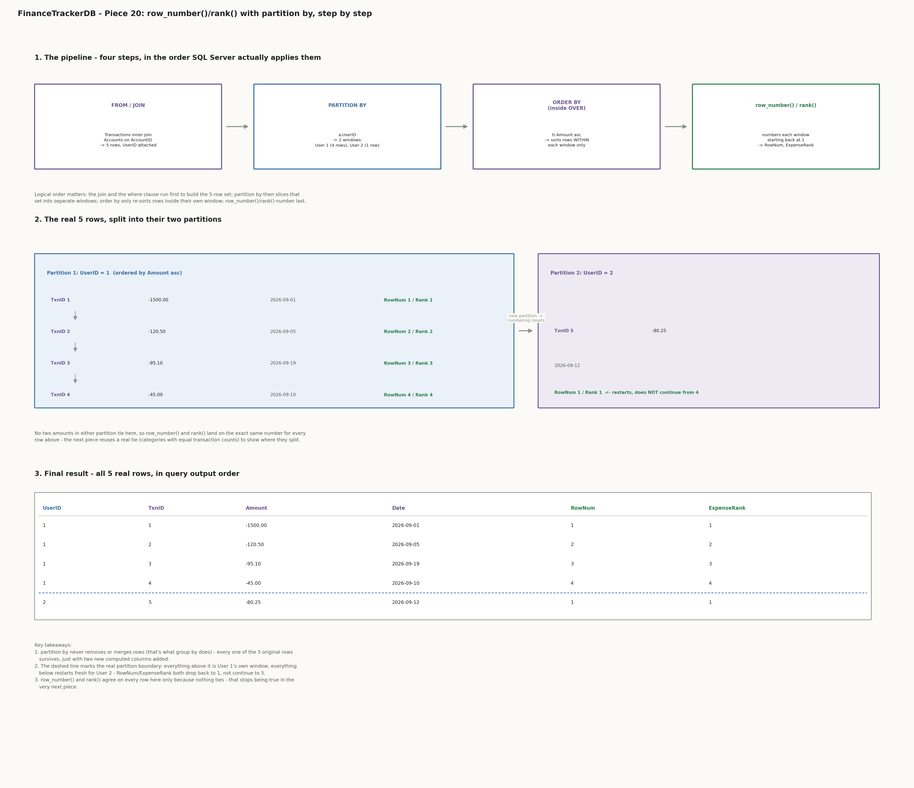
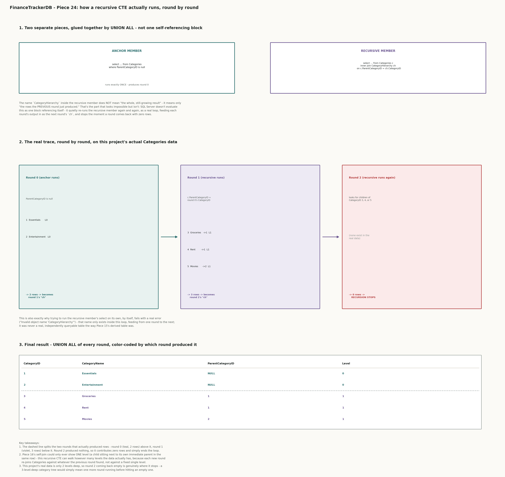

## Piece 20 — row_number() and rank() with partition by (ranking each user's transactions by amount)

```sql
select
    a.UserID,
    tr.TransactionID,
    tr.Amount,
    tr.TransactionDate,
    row_number() over (partition by a.UserID order by tr.Amount asc) as RowNum,
    rank() over (partition by a.UserID order by tr.Amount asc) as ExpenseRank
from Transactions tr
inner join Accounts a on tr.AccountID = a.AccountID
order by a.UserID, ExpenseRank;
```

Confirmed real output:

```
UserID  TransactionID  Amount    TransactionDate  RowNum  ExpenseRank
------  -------------  --------  ---------------  ------  -----------
1       1              -1500.00  2026-09-01       1       1
1       2              -120.50   2026-09-05       2       2
1       3              -95.10    2026-09-19       3       3
1       4              -45.00    2026-09-10       4       4
2       5              -80.25    2026-09-12       1       1

(5 rows affected)
```

Notes:
- **What we did and what it shows:** real proof of the full prediction — exactly 5 rows came back, User 1's 4 transactions ranked 1 through 4 by size (September rent, the biggest expense, landing at rank 1), and User 2's 1 transaction landing at rank 1 again instead of continuing on as rank 5. `RowNum` and `ExpenseRank` agree on every single row, exactly as predicted, because nothing in this real data ties.
- **How this connects to `04 sql window functions.md`:** §1 is exactly what `RowNum` demonstrates, and its "`group by` vs. `partition by` - the same bucket, two different outputs" sub-section is the precise reason all 5 original rows survived here instead of collapsing into 2 summary rows the way `group by a.UserID` would have — `partition by` tags every row with extra computed columns, it never removes or merges rows. `ExpenseRank` formally belongs to §2, "`rank()` and `dense_rank()` - ranking with ties," though this real data doesn't contain a tie yet to show `rank()`'s distinguishing behavior against `row_number()` — that is exactly what the next piece provides, using a real tie elsewhere in this project's data.
- **What this is really answering (interview-style scenario):** "show me each user's biggest expenses first, ranked just for them" — a personalized "top transactions" view is a realistic feature for a finance app's dashboard, and it genuinely needs `partition by` specifically because the ranking has to reset per user — a single global ranking across all users mixed together would rank User 2's only transaction against User 1's four, which isn't the question a per-user view is actually asking.
- **What this query is doing, explained simply:** picture two separate rooms, one for User 1 and one for User 2. Every transaction walks into the room that belongs to its owner. Inside each room, the transactions line up on their own, biggest expense first, smallest last. Then each one gets a number for its place in that line — 1st, 2nd, 3rd — but only counting the people in its own room. User 2's room only has one transaction in it, so that transaction is automatically "1st" in its room, even though it never stood next to anyone from User 1's room.

  A real-life version of this: think of a school handing out rank 1, rank 2, rank 3 separately in every classroom, instead of ranking the entire school together. A student who is "rank 1 in Class B" isn't being compared to Class A at all — each class restarts its own count at 1. That is what `partition by` does to the rows here: it puts them in separate classrooms first, before anything gets numbered.

  Where this shows up in real life: a finance app's "your biggest expenses" screen works exactly this way — every person sees their own list starting at number 1, and it never depends on how many transactions some other user happens to have.

  The same thing, step by step, in plain words:
  step 1 — join the two tables, so every transaction also shows which user owns it (because `Transactions` only knows the `AccountID`, not the `UserID`, so `Accounts` has to be joined in to supply it).
  step 2 — split the rows into separate groups, one group per user (`partition by a.UserID`). this is the "separate rooms" step.
  step 3 — inside each group only, sort the rows from biggest expense to smallest (`order by tr.Amount asc`).
  step 4 — number the rows in that sorted order, starting over at 1 in every group (`row_number()` and `rank()`).
  step 5 — a separate, final step decides what order the rows are shown on screen (the outer `order by a.UserID, ExpenseRank`) — this does not change the numbers from step 4, it only changes the order they're displayed in.

  Connecting it back to the technical terms: "separate rooms" is `partition by`, "line up inside the room" is the `order by` written inside `OVER()`, and "give out position numbers" is `row_number()`/`rank()`.
- **What this query is doing, technical step-by-step:** four things are happening in this query, and SQL Server applies them in this order regardless of how they're arranged on the page.

  1. **`from Transactions tr inner join Accounts a on tr.AccountID = a.AccountID`** runs first and builds the complete working set before anything else happens. This is the exact same UserID-bridging join reused from Pieces 15, 17, 18, and 19: `Transactions` never stores `UserID` directly, only `AccountID`, while `Accounts` does store `UserID` — so this join exists purely to attach each transaction to its owner before any ranking can happen. The result at this stage is all 5 real transactions, each now carrying its `UserID` alongside its own columns.

  2. **The two window functions' `OVER (partition by a.UserID order by tr.Amount asc)` clauses** each define a "window" — a slice of that 5-row working set — for their own function to operate over. `partition by a.UserID` splits the 5 rows into separate, independent groups, one per distinct `UserID`: this data has exactly 2 distinct values, so there are exactly 2 partitions — User 1's 4 transactions, and User 2's 1. `order by tr.Amount asc` then sorts the rows *within each partition only* — since every `Amount` here is a negative expense, ascending order puts the single biggest expense first in each partition. Note that this clause had to be written out twice, once for `row_number()` and once for `rank()` — a window function's `OVER` clause belongs to that one function call, it isn't shared automatically just because two functions happen to want the same window (SQL Server does have a named `WINDOW` clause that avoids the duplication, but that's a later convenience, not required here).

  3. **`row_number()` and `rank()`** then number the rows inside each partition, in the sorted order from step 2, restarting at 1 every time a new partition begins. That restart is the entire point of `partition by`: User 2's one transaction gets `RowNum`/`ExpenseRank` = 1, not 5, because its window is completely independent of User 1's.

  4. **The outer `order by a.UserID, ExpenseRank`** is a separate thing entirely from the `order by` inside the `OVER()` clauses, even though both happen to sort by amount-related logic here. The inner `order by` only controls the order used to *compute* the ranking inside each partition; the outer `order by` only controls the order the final rows are *displayed* in. They don't have to match — a query could rank rows by `Amount` internally while displaying them sorted by `TransactionDate` instead.

  Running `row_number()` and `rank()` side by side here, on real data, is deliberate rather than redundant: it's how this piece proves — rather than just asserts — that the two functions agree whenever nothing ties.
- **Visual representation:** the diagram below shows this same flow as a picture — the four-step pipeline at the top, then the real 5 rows split into their two real partitions underneath it, with the dashed line marking exactly where the numbering resets.



Questions along the way: none — understood on the first pass.

---

`row_number()` and `rank()` agreed on every row in Piece 20 because nothing in that data tied. This piece uses a real tie that already exists elsewhere in the project: three real categories have transactions tagged to them (Groceries, Rent, Movies — Piece 9's real data), and two more (Essentials, Entertainment) have none tagged directly, only through their children (Piece 16's self-join already established that hierarchy). Counting real transactions per category and ranking the categories by that count produces a genuine tie twice over — Rent and Movies both have exactly 1 transaction, and Essentials and Entertainment both have exactly 0 — which is exactly the real-data situation `04 sql window functions.md` §2 needs to show `rank()`'s defining behavior: it leaves a gap in the numbering after a tie (1, 2, 2, **4**, 4 — skipping 3 entirely, since two rows already used rank 2), while `dense_rank()` numbers the same tie without a gap (1, 2, 2, **3**, 3). `row_number()` is deliberately left out of this piece: with a tie, its tie-breaking order isn't guaranteed by this query, so it wouldn't have a single correct value to predict and confirm against the way `rank()` and `dense_rank()` do.

## Piece 21 — rank() and dense_rank() with a real tie (ranking every category by transaction count, including zero-count categories)

```sql
select
    c.CategoryID,
    c.CategoryName,
    count(tr.TransactionID) as TxnCount,
    rank() over (order by count(tr.TransactionID) desc) as CategoryRank,
    dense_rank() over (order by count(tr.TransactionID) desc) as CategoryDenseRank
from Categories c
left join Transactions tr on tr.CategoryID = c.CategoryID
group by c.CategoryID, c.CategoryName
order by CategoryRank, c.CategoryID;
```

Confirmed real output:

```
CategoryID  CategoryName   TxnCount  CategoryRank  CategoryDenseRank
----------  -------------  --------  ------------  -----------------
3           Groceries      3         1             1
4           Rent           1         2             2
5           Movies         1         2             2
1           Essentials     0         4             3
2           Entertainment  0         4             3

(5 rows affected)
```

Notes:
- **What this query is doing, explained simply:** every category gets counted up — how many real transactions does it actually have? Groceries has 3, Rent has 1, Movies has 1, and Essentials and Entertainment have 0 each, because nothing was ever tagged to them directly (only their children were). Once every category has a count, they get placed in order from most transactions to least, and `rank()`/`dense_rank()` hand out a position number for that order — like a leaderboard. The twist here is that two different pairs of categories end up with the exact same count, so two different categories can legitimately tie for the same position on the leaderboard, and this piece is about what happens to the numbering when that occurs.

  A real-life version of this: imagine a race where two runners cross the finish line at the exact same time and both get awarded "2nd place." `rank()` is strict about it: because two people are already standing on the 2nd place podium, nobody gets called "3rd place" at all — the next runner is announced as "4th place," even though only three people actually finished. `dense_rank()` is the friendlier version: it still gives both tied runners "2nd place," but the very next runner is called "3rd place" — no position number gets skipped.

  Where this shows up in real life: any leaderboard, ranking, or "top N" report that might contain ties — top sellers, highest scores, most active users — has to pick one of these two behaviors on purpose, because the two give genuinely different answers whenever two entries tie.

  The same thing, step by step, in plain words:
  step 1 — join every category to its transactions, keeping categories even when they have zero matches (`left join`, not `inner join` — an `inner join` here would have silently dropped Essentials and Entertainment entirely, since they have no direct transactions to match on).
  step 2 — count the real transactions per category (`count(tr.TransactionID)`), and shrink the result down to one row per category (`group by`).
  step 3 — order all 5 categories by that count, highest first (`order by count(tr.TransactionID) desc`, inside each window function's own `OVER()`).
  step 4 — hand out position numbers in that order, two different ways at once: `rank()` leaves a gap after a tie, `dense_rank()` does not.
- **What this query is doing, technical step-by-step:** four things are happening here, applied in this order regardless of how the query is laid out on the page.

  1. **`from Categories c left join Transactions tr on tr.CategoryID = c.CategoryID`** — a `left join` is required, not an `inner join`, specifically so that a category with zero matching transactions still produces one output row (with `tr.TransactionID` coming back `NULL` for that row) instead of disappearing from the result entirely. This is the only piece so far that deliberately needs categories with *no* transactions to survive the join.

  2. **`group by c.CategoryID, c.CategoryName`** collapses all the matching `Transactions` rows for each category down into a single summary row, and `count(tr.TransactionID)` counts how many of those matched rows have a real (non-`NULL`) `TransactionID` — which is exactly 0 for Essentials and Entertainment, since their one joined row has `tr.TransactionID = NULL`. `count()` never counts `NULL`s, which is what makes the zero show up correctly instead of counting 1 "empty" row.

  3. **`rank() over (order by count(tr.TransactionID) desc)` and `dense_rank() over (order by count(tr.TransactionID) desc)`** both run *after* the `group by` has already produced one row per category — this is allowed in SQL Server because window functions are logically evaluated after grouping, so `count(tr.TransactionID)` can be reused directly inside the `OVER()`'s `order by` even though it's an aggregate. Neither function uses `partition by` here, unlike Piece 20 — there's only one group (all 5 categories together), so the whole result is treated as a single window.

  4. **The difference in behavior:** with the real counts 3, 1, 1, 0, 0, both functions agree that Groceries is rank 1 and that Rent and Movies tie for rank 2. From there they diverge: `rank()` counts the two rows that already used "2" and jumps straight to 4 for the next distinct value, leaving "3" completely unused; `dense_rank()` only cares how many *distinct* count-values have been seen so far, so it moves straight to 3. Both are internally consistent, correct answers to two subtly different questions: "what position is this row in, counting every row ahead of it" (`rank()`) versus "how many distinct groups are ahead of this one" (`dense_rank()`).
- **How this connects to `04 sql window functions.md`:** §2, "`rank()` and `dense_rank()` - ranking with ties," is the section this piece exists to prove on real data — this project's own `Categories`/`Transactions` tables happened to already contain a genuine tie (twice over), so no artificial example was needed to show the gap-vs-no-gap difference.
- **What this is really answering (interview-style scenario):** "rank every category by how much real activity it has, and tell me honestly when two categories are tied" — a realistic reporting question, and also one of the most commonly asked SQL interview questions precisely because so many candidates don't realize `rank()` and `dense_rank()` disagree the moment a tie shows up.
- **Why `row_number()` was deliberately left out this time:** with a genuine tie in the data, `row_number()` still has to assign two different numbers to Rent and Movies (it never repeats a number), but SQL Server doesn't guarantee *which* of the two gets 2 and which gets 3 without an explicit tiebreaker column — so there's no single correct value to predict in advance and confirm against, the way there is for `rank()`/`dense_rank()`. That unpredictability is itself the reason `rank()`/`dense_rank()` exist as separate functions from `row_number()`.

Questions along the way: none — understood on the first pass.

---

`row_number()`, `rank()`, and `dense_rank()` are all done now, including a real tie to prove where they actually differ. `04 sql window functions.md` §3 covers the other pair on the Required Coverage checklist: `lag()` and `lead()`, which don't rank anything — they look sideways at a neighboring row instead, one step back (`lag()`) or one step forward (`lead()`) within the same ordered partition. The clearest real question this project can ask with them is a trend question Piece 20's per-user ranking couldn't answer on its own: for each user, going transaction by transaction in date order, was the next transaction bigger or smaller than the one before it?

## Piece 22 — lag() and lead() (comparing each transaction to the one before and after it, per user, in date order)

```sql
select
    a.UserID,
    tr.TransactionID,
    tr.TransactionDate,
    tr.Amount,
    lag(tr.Amount) over (partition by a.UserID order by tr.TransactionDate) as PrevAmount,
    lead(tr.Amount) over (partition by a.UserID order by tr.TransactionDate) as NextAmount
from Transactions tr
inner join Accounts a on tr.AccountID = a.AccountID
order by a.UserID, tr.TransactionDate;
```

Confirmed real output:

```
UserID  TransactionID  TransactionDate  Amount    PrevAmount  NextAmount
------  -------------  ---------------  --------  ----------  ----------
1       1              2026-09-01       -1500.00  NULL        -120.50
1       2              2026-09-05       -120.50   -1500.00    -45.00
1       4              2026-09-10       -45.00    -120.50     -95.10
1       3              2026-09-19       -95.10    -45.00      NULL
2       5              2026-09-12       -80.25    NULL        NULL

(5 rows affected)
```

Notes:
- **What this query is doing, explained simply:** imagine User 1's transactions laid out in a single-file line, in the order they actually happened by date — not by `TransactionID`, which is why TxnID 4 (dated 09-10) appears *between* TxnID 2 (09-05) and TxnID 3 (09-19) in this output, out of ID order but in true date order. For every transaction in that line, `PrevAmount` is "what's the amount on the transaction standing right before me," and `NextAmount` is "what's the amount on the transaction standing right after me." The very first person in line has nobody standing in front of them, so their `PrevAmount` comes back empty (`NULL`). The very last person has nobody behind them, so their `NextAmount` comes back empty too.

  A real-life version of this: picture people queued up at a checkout counter. Each person can turn around and ask "how much did the person just ahead of me spend?" (`lag`) or "how much is the person just behind me about to spend?" (`lead`). The person at the very front of the queue has nobody ahead to ask — there's simply no answer, not a zero, an actual "nothing there." Same for the person at the very back asking about who's behind them.

  Where this shows up in real life: any "what changed since last time" or "is this trending up or down" feature — a spending-trend arrow next to a transaction, a stock price's day-over-day change, a step counter comparing today to yesterday — is built on exactly this "look at my neighbor" idea.

  The same thing, step by step, in plain words:
  step 1 — join the two tables, so every transaction also shows which user owns it, same bridge as every other piece since Piece 15.
  step 2 — split the rows into separate lines, one line per user (`partition by a.UserID`) — User 2's line only has 1 person in it.
  step 3 — inside each line, put the transactions in true date order (`order by tr.TransactionDate`), not ID order.
  step 4 — for every transaction, look one step back (`lag`) and one step forward (`lead`) within its own line only, and come back empty at either end of the line.
- **What this query is doing, technical step-by-step:** four things happen here, applied in this order regardless of how the query is written on the page.

  1. **`from Transactions tr inner join Accounts a on tr.AccountID = a.AccountID`** builds the same 5-row UserID-bridged working set reused since Piece 15 — every transaction, now carrying its owner's `UserID`.

  2. **`lag(tr.Amount) over (partition by a.UserID order by tr.TransactionDate)`** and **`lead(tr.Amount) over (...)`** share the same window definition as each other (same `partition by`/`order by`, written out twice, same reason as Piece 20): split the 5 rows into 2 partitions by `UserID`, then sort each partition by `TransactionDate` rather than `Amount` this time — the ordering column is what defines "before" and "after" for `lag`/`lead`, so it had to change from Piece 20's amount-based ordering to a genuinely chronological one for "before/after" to mean something real.

  3. **`lag()` reads the `Amount` value from the row one position back** in that chronological order, within the same partition; **`lead()` reads the `Amount` value from the row one position forward**. Both default to `NULL` when there is no such row — SQL Server doesn't wrap around to the other end of the partition or borrow a value from a different partition; it genuinely returns nothing.

  4. **Why the result lands in `TransactionID` order 1, 2, 4, 3 for User 1, not 1, 2, 3, 4:** the outer `order by a.UserID, tr.TransactionDate` displays rows by date, and TxnID 4 ("Movie night," 09-10) genuinely happened chronologically between TxnID 2 (09-05) and TxnID 3 (09-19) — this is the same project data as always, just finally sorted by when things happened rather than by the order they were inserted.
- **How this connects to `04 sql window functions.md`:** §3, "`lag()` and `lead()` - looking at neighboring rows," together with its "`lag()`/`lead()` with `partition by` - multiple separate sequences, not one" sub-section, is exactly this piece: two separate per-user sequences, each with its own independent start and end, rather than one long sequence spanning both users (which would have wrongly let User 2's single transaction "borrow" a neighbor from User 1's list).
- **What this is really answering (interview-style scenario):** "for each of my transactions, how does it compare to the one right before and right after it" is the mechanism behind a "spending went up/down from last time" indicator on a transaction list — a common feature request, and `lag()`/`lead()` exist specifically so this doesn't require a self-join or a manual subquery to answer.
- **Real proof the partition boundary holds here too:** User 2 has exactly 1 transaction and both `PrevAmount` and `NextAmount` came back `NULL` for it — not borrowed from User 1's last or first transaction — confirming `partition by` keeps `lag()`/`lead()` just as contained as it kept `row_number()`/`rank()` in Piece 20.

Questions along the way: none — understood on the first pass.

---

Every window function on the Required Coverage checklist has now run except one: `04 sql window functions.md` §4, running totals with `sum() over()`. This is also the most directly useful one for a finance app specifically — a running balance that updates with every transaction, the kind of number a real account screen shows next to each line item. This project's `Accounts.Balance` column has sat at a placeholder 0.00 since Piece 4 for exactly this reason: a real running balance is something a query computes from transaction history, not a number the schema stores and hopes stays in sync.

## Piece 23 — sum() over() (running balance per account, in date order)

```sql
select
    tr.AccountID,
    tr.TransactionID,
    tr.TransactionDate,
    tr.Amount,
    sum(tr.Amount) over (partition by tr.AccountID order by tr.TransactionDate
                          rows between unbounded preceding and current row) as RunningTotal
from Transactions tr
order by tr.AccountID, tr.TransactionDate;
```

Confirmed real output:

```
AccountID  TransactionID  TransactionDate  Amount    RunningTotal
---------  -------------  ---------------  --------  ------------
1          1              2026-09-01       -1500.00  -1500.00
1          2              2026-09-05       -120.50   -1620.50
1          3              2026-09-19       -95.10    -1715.60
2          4              2026-09-10       -45.00    -45.00
3          5              2026-09-12       -80.25    -80.25

(5 rows affected)
```

Notes:
- **What this query is doing, explained simply:** think of a jar for each account, starting empty. Every time a transaction happens on that account, its amount gets dropped into the jar, and `RunningTotal` tells you the jar's total *right after* that transaction dropped in — not before, not after any later ones. Account 1 had three transactions, so its jar gets checked three times, each time showing a bigger (more negative) total than the last. Accounts 2 and 3 each only had one transaction, so their jar's running total is just that one transaction, since there was nothing dropped in before it.

  A real-life version of this: think of a checkbook register, the old paper kind, where every line has its own "balance after this transaction" column, filled in by hand, one line at a time, adding the new line to whatever the balance already was above it. `RunningTotal` is exactly that column, except SQL recalculates it instantly for every row instead of someone doing the arithmetic by hand.

  Where this shows up in real life: this is the single most common use of a window function in a finance app specifically — the number shown next to every transaction on a bank statement or account screen, saying "your balance was this much right after this transaction."

  The same thing, step by step, in plain words:
  step 1 — split the transactions into separate jars, one jar per account (`partition by tr.AccountID`) — a running total for one account should never include another account's money.
  step 2 — inside each jar, line the transactions up by date (`order by tr.TransactionDate`), oldest first, since a running total only makes sense in chronological order.
  step 3 — at each transaction, add up every amount from the very first one in that jar up through this one, and nothing after it (that's what the question specifically asks about below).
- **What this query is doing, technical step-by-step:** three things happen here, applied in this order regardless of how the query is written on the page.

  1. **`from Transactions tr`** — no join to `Accounts` was needed this time, unlike every window-function piece before it. `AccountID` already lives directly on `Transactions`, and this query only needs to group by account, not by user — so the UserID-bridging join from Pieces 15, 17-22 simply isn't necessary here.

  2. **`partition by tr.AccountID order by tr.TransactionDate`** splits the 5 rows into 3 partitions (one per real `AccountID`: 1, 2, 3) and sorts each partition chronologically — the same `partition by`/`order by` pattern as every other window function piece, just partitioned one level more granular (by account rather than by user, since two of User 1's accounts, Checking and Savings, need two separate running balances, not one combined one).

  3. **`sum(tr.Amount)`** adds up the `Amount` values of every row inside the frame the next part defines, for each row.

- **`rows between unbounded preceding and current row` — what this is doing, specifically:** this is called the **frame clause**, and it is a third, separate piece of a window function's definition, alongside `partition by` (which rows are even in play) and `order by` (what order to process them in). The frame clause answers a different question from either of those: for *this specific row*, exactly which of the other rows already selected into its partition should actually get added into the `sum()` — all of them, or only some? `unbounded preceding` means "start from the very first row in this partition, no limit on how far back" — that's the left edge of the frame. `current row` means "stop at the row being calculated right now, don't include anything after it" — that's the right edge. Put together, the frame grows by exactly one row every time the calculation moves to the next row: for TransactionID 1 (the first in Account 1's partition), the frame is just that one row, so `RunningTotal` = `Amount`. For TransactionID 2, the frame now covers rows 1 and 2, so `RunningTotal` = both amounts added together. For TransactionID 3, the frame covers all three — that is exactly why the numbers 1500.00, then 1620.50, then 1715.60 keep growing instead of resetting: each row's frame is a strict superset of the one before it, never a completely different window.

  Worth knowing for later: SQL Server actually defaults to this exact frame (`range between unbounded preceding and current row`, which behaves the same as `rows` here since no two dates tie within a partition) whenever `order by` is present inside `OVER()` and no frame is written at all — so this clause was technically optional for this specific query. It was still written out explicitly on purpose: relying on an unwritten default is a common real source of subtle bugs once the data has ties, because `range` (the default) treats *tied* `order by` values as one combined group, while `rows` (what's written here) always treats every physical row separately even when two rows tie on the ordering column. Writing the frame out by hand removes any doubt about which behavior is actually running.
- **How this connects to `04 sql window functions.md`:** §4, "`sum() over()` - running totals," is exactly this piece, and is also the doc's most directly finance-relevant example — this project's own `Accounts.Balance` column has sat at a placeholder 0.00 since Piece 4 precisely because a real balance is a running total computed from transaction history, which is what this query now proves it can do on real data.
- **What this is really answering (interview-style scenario):** "show me my balance after every transaction, per account" is one of the most common real screens a finance app has, and `sum() over()` with this exact frame clause is the standard way to answer it — the alternative (a correlated subquery re-summing everything before each row, one row at a time) does the same job far less efficiently.

Questions along the way: none — understood on the first pass.

---

Every window function on the Required Coverage checklist is done — `row_number()`, `rank()`, `dense_rank()`, `lag()`, `lead()`, and `sum() over()` with an explicit frame clause, all proven on this project's own real data. The checklist's next item is Common Table Expressions, `05 sql ctes.md` — and this project already has unfinished business with one: Piece 15's full outer join used a derived table (an inline subquery in the `FROM` clause) specifically because CTEs hadn't been covered yet, with an explicit note that it was "a strong candidate to revisit... once that piece comes up." A plain CTE (`with ... as (...)`) would just be a cleaner way to write that same derived table. A more interesting use of a CTE, though, is one a derived table structurally cannot do at all: a **recursive** CTE, which can walk a hierarchy of unknown depth — and this project already has a real hierarchy to walk, `Categories.ParentCategoryID`, the same self-referencing relationship Piece 16's self-join covered. The difference this piece will make visible: Piece 16's self-join can only ever see one level — a child and its immediate parent, in the same row — while a recursive CTE can walk every level, however many there turn out to be, starting from the top and working down.

## Piece 24 — a recursive CTE (walking the full Categories hierarchy, top to bottom)

```sql
with CategoryHierarchy as (
    select CategoryID, CategoryName, ParentCategoryID, 0 as Level
    from Categories
    where ParentCategoryID is null

    union all

    select c.CategoryID, c.CategoryName, c.ParentCategoryID, ch.Level + 1
    from Categories c
    inner join CategoryHierarchy ch on c.ParentCategoryID = ch.CategoryID
)
select CategoryID, CategoryName, ParentCategoryID, Level
from CategoryHierarchy
order by Level, CategoryID;
```

Confirmed real output:

```
CategoryID  CategoryName   ParentCategoryID  Level
----------  -------------  ----------------  -----
1           Essentials     NULL              0
2           Entertainment  NULL              0
3           Groceries      1                 1
4           Rent           1                 1
5           Movies         2                 1

(5 rows affected)
```

Notes:
- **What this query is doing, explained very simply, broken into small pieces:** this is the one thing that actually makes it feel confusing, so it gets its own plain-English name: this is not really "a query joining itself." It is one query that quietly **runs multiple times in a row**, like a loop, and each time it runs it only looks at what the *previous* run just found — never the whole growing pile of results, and never itself while it's still running.

  Think of it like passing a note around a circle of people, one person at a time:
  - **Person 1 (the anchor member)** writes down the names of the two categories that have no parent at all — Essentials and Entertainment — and passes that small note on. Person 1 only ever does this once.
  - **Person 2 (the recursive member, round 1)** receives that note (just those 2 names), and asks "does `Categories` have anyone whose parent is one of the names on this note?" It finds 3 — Groceries and Rent (children of Essentials) and Movies (child of Entertainment) — writes *those* 3 names on a brand new note, and passes that new note on.
  - **Person 2 does the exact same thing again (round 2)**, but now holding the note with only 3 names on it (Groceries, Rent, Movies). It asks "does anyone have one of THESE as a parent?" Nobody does — none of these three categories have any children in the real data — so this round's note comes back completely blank.
  - **A blank note is the stop signal.** Nobody is told in the SQL "stop after 2 rounds" — the loop simply ends itself the moment a round finds nothing new to add.
  - Every note that got written down along the way — person 1's 2 names, person 2's first 3 names, and person 2's second blank note (which adds nothing) — all get stacked together into one final pile. That stacking is literally what the `union all` in the middle of the query is doing: gluing every round's output together into the single final result, 5 rows total.

  A real-life version of this: think of finding everyone in a family tree starting from a grandparent — first you write down the grandparent, then you find their kids, then you go find THEIR kids, and you keep going down generation by generation until a generation turns up with no kids at all, which is when you naturally stop. Nobody has to tell you in advance how many generations there are.

  Where this shows up in real life: any menu, folder structure, org chart, or comment-thread-with-replies feature — anything where an item can contain more of itself, nested to an unknown depth — is built on exactly this pattern. A single category's parent (Piece 16's self-join) only ever gives you one generation; this recursive CTE can walk the whole family tree, however deep it turns out to be.

  **The specific part that was going over your head, named directly:** when the recursive member writes `inner join CategoryHierarchy ch`, that is NOT "joining itself to the whole final answer," and it's not actually recursive in a scary self-referencing way either — `CategoryHierarchy` there means "whatever note was just passed to me a moment ago," nothing more. SQL Server enforces this: you genuinely cannot see the whole accumulated table from inside the recursive member, only the previous round's rows — which is also exactly why trying to run that `select` on its own, outside the `with` block, fails with the real error on this project's own `.sql` file: `Invalid object name 'CategoryHierarchy'`. That name was never a real, independently queryable table the way Piece 15's derived table was — it only exists as this one-round-at-a-time hand-off, and only inside this query.
- **What this query is doing, technical step-by-step:** two members, glued together, running as an iterative loop rather than a single self-referencing evaluation.

  1. **The anchor member** — `select CategoryID, CategoryName, ParentCategoryID, 0 as Level from Categories where ParentCategoryID is null` — runs exactly once and seeds the recursion. It must be a query that does NOT reference `CategoryHierarchy` at all, since nothing exists to reference yet. On this real data it returns 2 rows (CategoryID 1 and 2), and the literal `0 as Level` is what starts the depth counter at the top of the tree.

  2. **`union all`** is what structurally joins the anchor member to the recursive member — not a regular join on a column, just "stack these result sets on top of each other," the same operator from Piece 17, except `union all` specifically (not plain `union`) because a recursive CTE is not allowed to deduplicate between rounds; each round's rows are kept exactly as produced.

  3. **The recursive member** — `select c.CategoryID, c.CategoryName, c.ParentCategoryID, ch.Level + 1 from Categories c inner join CategoryHierarchy ch on c.ParentCategoryID = ch.CategoryID` — is the part SQL Server re-executes, round after round, substituting in only the PREVIOUS round's output wherever `CategoryHierarchy` (aliased `ch`) appears. Round 1 sees `ch` = the anchor's 2 rows, and finds every `Categories` row whose `ParentCategoryID` matches one of those 2 `CategoryID`s — the 3 children, each one level deeper (`ch.Level + 1` turns round 0's `Level = 0` into `Level = 1`). Round 2 sees `ch` = those same 3 rows from round 1, looks for children of CategoryID 3, 4, or 5, and finds none — an empty result, which is the built-in termination condition: SQL Server stops recursing the instant a round adds zero new rows, with no explicit `stop` or loop counter written anywhere in the SQL.

  4. **The final `select ... from CategoryHierarchy`**, outside the `with` block, is the only place `CategoryHierarchy` means "everything from every round combined" — all 5 rows, from the `union all` of round 0's 2 plus round 1's 3 (round 2 contributed 0 and ended things). The closing `order by Level, CategoryID` just controls display order; it has nothing to do with the recursion itself, which already finished before this line runs.
- **How this connects to `05 sql ctes.md` and `02 sql joins.md`:** `05 sql ctes.md` covers the plain, non-recursive CTE as a cleaner way to write Piece 15's derived table — this piece goes further, into recursive CTEs specifically, which a plain derived table or subquery cannot do at all (a derived table is evaluated once, it can't re-run itself against its own prior output). This also directly extends `02 sql joins.md`'s self-join material from Piece 16: Piece 16's `child.ParentCategoryID = parent.CategoryID` self-join is structurally the same comparison used inside this recursive member — the difference is Piece 16 ran that comparison exactly once (one level), while this piece re-runs the identical comparison once per round until a round comes up empty, which is what lets it reach arbitrary depth instead of just one level.
- **Visual representation:** the diagram below shows the full trace — the anchor/recursive split at the top, the real 3-round "pass the note along" execution in the middle (including the real round 2 that comes back empty and stops everything), and the final 5-row result at the bottom, color-coded by which round actually produced each row.



- **Real proof of the limitation this piece's own data has:** this project's `Categories` table is only 2 levels deep (a handful of parents, and their direct children — no grandchildren), so round 2 genuinely coming back with 0 rows is what naturally stopped the recursion here. The mechanism this piece demonstrates would keep going exactly the same way for a 3rd, 4th, or 10th level, if the real data had one — nothing about the query itself is limited to 2 levels, only this project's current real `Categories` rows are.

Questions along the way: none — understood on the first pass.

---

CTEs are done — a plain derived-table-style CTE was effectively already covered conceptually back in Piece 15's notes, and this piece covered the genuinely new part, recursion. The Required Coverage checklist's next item is indexes and execution plans, `06 sql indexes execution plans.md` — and this is the one piece on the whole checklist that can't honestly run on this project's current real data as-is. Indexes exist to make SQL Server avoid scanning every row; with only 5 real `Transactions` rows, a full table scan and an index seek cost basically the same, so a genuine before/after proof (one query plan scanning, the same query after an index seeking instead) needs real data at real scale — the spec itself calls for "thousands of transactions, not a handful" for exactly this reason.

Rather than skip indexing or fake the scale, the next piece bulk-seeds `Transactions` up to real volume first, so the indexing piece right after it can show a genuine, measurable before/after on this project's own real (if synthetic-content) data — same "real confirmed output only" discipline as every other piece, just applied to a bigger table.

## Piece 25 — bulk-seeding Transactions to real scale (5,000 synthetic rows)

```sql
;with Tally as (
    select top (5000) row_number() over (order by (select null)) as n
    from sys.all_columns a cross join sys.all_columns b
)
insert into Transactions (AccountID, CategoryID, TransactionDate, Amount, Description)
select
    AccountID       = (abs(checksum(newid())) % 3) + 1,
    CategoryID      = case abs(checksum(newid())) % 3
                           when 0 then 3   -- Groceries
                           when 1 then 4   -- Rent
                           else 5          -- Movies
                       end,
    TransactionDate = dateadd(day, -(abs(checksum(newid())) % 730), '2026-10-11'),
    Amount          = cast(-1 * ((abs(checksum(newid())) % 499900) / 100.0 + 1) as decimal(10,2)),
    Description     = 'Synthetic transaction #' + cast(n as varchar(10))
from Tally;

select count(*) as TotalTransactions from Transactions;
```

Confirmed real output:

```
TotalTransactions
-----------------
5005

(1 row affected)
```

Notes:
- **What this query is doing, explained simply:** picture a machine that stamps out 5,000 blank transaction slips, one after another, and for every single slip it rolls several separate, independent dice: one die decides which of the 3 real accounts the slip belongs to, another decides which of the 3 real categories, another decides how many days ago it happened, and another decides how much money it was for. Nothing about slip #247 influences slip #248 — each slip's dice rolls are completely fresh and unrelated to every other slip's. By the end, 5,000 brand-new, randomly-filled-in transactions have been dropped into the real `Transactions` table, on top of the 5 real ones already there since Piece 9 — which is exactly why the final count comes back 5005, not 5000.

  A real-life version of this: think of a raffle drum that gets spun fresh for every single ticket, rather than being spun once and that one result copied onto every ticket. Each spin is independent, so two tickets can land on completely different numbers even though they came from the same drum.

  Where this shows up in real life: this exact pattern — generate a large batch of realistic fake data fast — is what QA engineers and database teams do constantly to "load test" a database or practice tuning it, without needing to wait for thousands of real users to generate thousands of real rows first.

  **Why the query itself is complex — the short version before the line-by-line breakdown below:** every single value in this query is being randomly chosen, and SQL Server doesn't have a simple built-in "give me a random number" button the way some other tools do — it has to be built out of a trick (`checksum(newid())`), and that same trick has to be repeated, separately, for every single column that needs its own independent random choice. That repetition is most of why it looks dense.
- **What this query is doing, technical step-by-step — the full formula, broken down line by line:** this is the part that was flagged as complex, so it's worth walking through slowly, piece by piece. The core trick behind every random value in this query is the same three functions stacked together: `newid()` generates a brand-new, genuinely random GUID (a long unique ID) every time it's called — literally once per row, not once per query; `checksum(newid())` converts that GUID into an ordinary integer, which can come out negative; `abs(...)` strips the negative sign off, so the result is always a positive whole number. Everything else in each line is just shaping that one random positive integer into the right range for that column.

  **`AccountID = (abs(checksum(newid())) % 3) + 1`** — `% 3` is the modulo operator: it divides by 3 and keeps only the remainder, which can only ever be 0, 1, or 2, no matter how big the random number was. `+ 1` shifts that up to 1, 2, or 3 — exactly matching the 3 real `AccountID`s that already exist in `Accounts` (Piece 4), so every synthetic transaction lands on a real account, never a fake one.

  **`CategoryID = case abs(checksum(newid())) % 3 when 0 then 3 when 1 then 4 else 5 end`** — this calls `newid()` again, completely separately from the `AccountID` line above, so the category chosen for a row has nothing to do with which account got chosen for that same row — they're independent dice rolls. `% 3` again gives 0, 1, or 2, and the `case ... when ... then ... end` (first seen as a case-matching tool back when categories were seeded) translates each of those three outcomes into one of the three real leaf `CategoryID`s this project actually tags transactions with — 3 (Groceries), 4 (Rent), or 5 (Movies) — matching the exact same real-data convention Piece 9 established: transactions are tagged to specific leaf categories, never to the parent categories Essentials (1) or Entertainment (2) directly.

  **`TransactionDate = dateadd(day, -(abs(checksum(newid())) % 730), '2026-10-11')`** — another fresh, independent `newid()` call. `% 730` gives a number from 0 to 729 — roughly 2 years' worth of individual days. The `-` in front makes that number negative, and `dateadd(day, -N, '2026-10-11')` means "take this fixed date and go back N days" — so the result lands anywhere from today itself (when the random number happens to be 0) to just over 2 years in the past (when it's 729), spreading the 5,000 rows realistically across a 2-year window instead of bunching them all on one date.

  **`Amount = cast(-1 * ((abs(checksum(newid())) % 499900) / 100.0 + 1) as decimal(10,2))`** — the most layered line, so it unpacks in order, inside out: `% 499900` (yet another fresh `newid()`) gives a whole number from 0 to 499,899. `/ 100.0` divides that by 100 — dividing by a decimal number specifically (`100.0`, not plain `100`) forces SQL Server to do decimal division and keep the cents, instead of integer division, which would just throw the cents away — turning the 0-to-499,899 range into 0.00 to 4998.99. `+ 1` nudges that up to 1.00-4999.99, so no synthetic transaction is ever exactly $0.00. `-1 * (...)` flips the whole thing negative, matching this project's established rule since Piece 9 that spending is recorded as a negative `Amount`. Finally, `cast(... as decimal(10,2))` locks the result to exactly 2 decimal places, matching `Transactions.Amount`'s real column type (Piece 8) — without this cast, the division above could leave extra floating-point noise past the cents place.

  **`Description = 'Synthetic transaction #' + cast(n as varchar(10))`** — `n` is the row counter from the `Tally` CTE (1 through 5000, the same counter the bulk-seed stub introduced). `cast(n as varchar(10))` converts that number into text, since SQL Server won't let `+` glue a number directly onto a string — both sides of a string `+` have to be text. The result is a label like "Synthetic transaction #4821", which makes every one of these 5,000 rows clearly identifiable as synthetic later, as opposed to the 5 real, hand-entered ones from Piece 9.

  **Why `newid()` had to be called separately in every single line, instead of once and reused:** each `newid()` call produces a brand-new random value specific to that one call. If the *same* random value had been computed once and reused for `AccountID`, `CategoryID`, `TransactionDate`, and `Amount` all together, those four values would move in lockstep with each other in an unrealistic way — every row with, say, `AccountID = 1` would also always get the exact same `CategoryID`, the exact same date offset, and the exact same amount, since they'd all be derived from one shared number. Calling `newid()` fresh for each column is what keeps the four random choices genuinely independent of each other, the way real, unrelated transactions actually are.
- **How this connects to `06 sql indexes execution plans.md`:** this piece exists purely to set up that doc's material — its own "the schema we're using" section opens by noting that index behavior only becomes measurable at real volume, which is exactly the gap this bulk-seed closes before the next piece runs.
- **What this is really answering (interview-style scenario):** "how would you generate realistic test data at scale without waiting for real users" is a genuinely common interview and on-the-job question, and the `sys.all_columns cross join sys.all_columns` tally-table pattern plus `checksum(newid())` randomization is a standard, reusable answer to it — not something specific to this one project.

Questions along the way: none — understood on the first pass.

---

With `Transactions` now at 5,005 real rows, there's finally enough scale to show indexing honestly. `06 sql indexes execution plans.md` is next on the Required Coverage checklist — the plan is to run a realistic query (one that filters or searches `Transactions`) before any index exists on the relevant column, capture its real execution plan and I/O cost (a table scan, reading all 5,005 rows), then add a non-clustered index on that column and run the identical query again to capture the real difference (an index seek, reading far fewer rows) — a genuine before/after, not an assumed one.

## Piece 26 — indexes & execution plans, the "before" baseline (no index yet)

```sql
set statistics io on;

select TransactionID, AccountID, CategoryID, TransactionDate, Amount
from Transactions
where TransactionDate >= '2026-07-01' and TransactionDate < '2026-08-01';

set statistics io off;
```

Confirmed real output:

```
TransactionID  AccountID  CategoryID  TransactionDate  Amount
-------------  ---------  ----------  ---------------  --------
12             2          5           2026-07-06       -3621.18
32             2          5           2026-07-26       -3006.88
43             2          5           2026-07-07       -2668.54
49             3          3           2026-07-10       -2897.22
111            3          3           2026-07-09       -542.07
...            ...        ...         ...              ...        (rows truncated here for length - 255 real rows total)
4924           2          4           2026-07-01       -2406.98
4926           3          5           2026-07-07       -3101.33
4963           2          4           2026-07-03       -864.14
5001           2          5           2026-07-19       -2188.81

(255 rows affected)

-- Messages tab:
Table 'Transactions'. Scan count 1, logical reads 42, physical reads 0, page server reads 0, read-ahead reads 0,
page server read-ahead reads 0, lob logical reads 0, lob physical reads 0, lob page server reads 0,
lob read-ahead reads 0, lob page server read-ahead reads 0.
```

Notes:
- **What this query is doing, explained simply:** imagine a 5,005-page phone book with no alphabetical order and no tabs — if someone asks "find every entry from July," the only honest way to answer is to flip through every single page and check each one. That's what `set statistics io` just proved really happened: `Scan count 1` means SQL Server made one single pass through the table, and `logical reads 42` is literally how many data pages it had to open and read along the way to find the 255 matching rows — it couldn't skip a single page, because nothing tells it where July's entries live.

  A real-life version of this: looking for every birthday card addressed to people born in July, in a shoebox of cards thrown in with no order at all. The only way to find them all is to pick up and check every single card in the box, even the ones from January and December.

  Where this shows up in real life: this is exactly the moment a real production database starts to feel slow — a report or search feature that worked fine with a handful of test rows suddenly takes much longer once a table has millions of real rows, because every query like this one is quietly reading the *entire* table just to find a small slice of it.

  The same thing, step by step, in plain words:
  step 1 — `set statistics io on` turns on a reporting feature that makes SQL Server tell the truth about how much work it actually did, printed to the Messages tab, separate from the actual query results.
  step 2 — the `select ... where TransactionDate >= ... and TransactionDate < ...` runs exactly as written, filtering for one month's worth of transactions.
  step 3 — with no index to guide it, SQL Server reads every page of the table (a "scan"), checking every row's `TransactionDate` against the filter one by one, keeping the 255 that match and discarding the rest.
  step 4 — `set statistics io off` turns the reporting feature back off so it doesn't keep printing on every later query in the same session.
- **What this query is doing, technical step-by-step:** `Scan count 1, logical reads 42` is the whole story. "Scan" here specifically means a **table/clustered index scan** — SQL Server walked the table's data pages from start to end rather than jumping to a specific location, which is the only option available when no index exists on the column being filtered (`TransactionDate`). "Logical reads" counts how many 8-KB data pages were pulled from the buffer cache to answer the query — 42 pages is effectively the real, physical size of all 5,005 rows of `Transactions` on disk right now (5,005 narrow rows comfortably fit in roughly that many pages). The key thing to hold onto for the next piece: that 42-page cost is paid in full *regardless* of how selective the filter is — this query only kept 255 of 5,005 rows (about 5%), but it still had to read all 42 pages to find them, because a scan can't tell in advance which pages contain a match.
- **How this connects to `06 sql indexes execution plans.md`:** §1's "What does 'indexed column' actually mean?" section is this exact scenario — `TransactionDate` has never been indexed, so SQL Server's only real option is the clustered index scan just proven here. This number, 42 logical reads for a full scan, is now the real baseline the next piece's index has to actually beat.
- **What this is really answering (interview-style scenario):** "why is this report slow, and how would you prove it" is one of the most practical, common interview and on-the-job questions in SQL — `set statistics io` is the honest, text-based way to answer it with real numbers instead of a guess, and it is exactly the tool a developer reaches for before and after adding an index, to prove the index actually helped rather than assuming it did.

Questions along the way: none — understood on the first pass.

---

42 logical reads and a full scan is now the real, confirmed baseline. The next step is the "after": add a non-clustered index on `TransactionDate`, the exact column this query filters on, and run the identical query again to see what SQL Server actually chooses to do with it available. Worth being honest about what to expect here, rather than assuming a dramatic win: a plain index on `TransactionDate` alone tells SQL Server where the matching rows are, but this query also selects `AccountID`, `CategoryID`, and `Amount`, which aren't part of that index — so for each of the 255 matching rows, SQL Server may have to do an extra "key lookup" back into the full table to fetch those other columns. Whether that ends up cheaper or more expensive than the original 42-page scan is a real question this piece will measure, not assume.

## Piece 27 — indexes & execution plans, the "after" (a non-covering index, run for real)

```sql
create index IX_Transactions_TransactionDate on Transactions(TransactionDate);

set statistics io on;

select TransactionID, AccountID, CategoryID, TransactionDate, Amount
from Transactions
where TransactionDate >= '2026-07-01' and TransactionDate < '2026-08-01';

set statistics io off;
```

Confirmed real output:

```
TransactionID  AccountID  CategoryID  TransactionDate  Amount
-------------  ---------  ----------  ---------------  --------
12             2          5           2026-07-06       -3621.18
32             2          5           2026-07-26       -3006.88
43             2          5           2026-07-07       -2668.54
49             3          3           2026-07-10       -2897.22
111            3          3           2026-07-09       -542.07
...            ...        ...         ...              ...        (rows truncated here for length - 255 real rows total)
4924           2          4           2026-07-01       -2406.98
4926           3          5           2026-07-07       -3101.33
4963           2          4           2026-07-03       -864.14
5001           2          5           2026-07-19       -2188.81

(255 rows affected)

-- Messages tab:
Table 'Transactions'. Scan count 1, logical reads 42, physical reads 1, page server reads 0, read-ahead reads 40,
page server read-ahead reads 0, lob logical reads 0, lob physical reads 0, lob page server reads 0, lob read-ahead reads 0,
lob page server read-ahead reads 0.
```

Notes:
- **What this query is doing, explained simply:** this is the real, honest surprise this piece was set up to find out: the new index got created successfully, but when the same question got asked again, SQL Server looked at the new index, looked at the old plain scan, and picked the **scan again anyway** — `logical reads` came back **42, exactly the same number as Piece 26, before the index even existed.** Adding the index did not make this particular query any cheaper, in reality, right now.

  A real-life version of this: imagine a library adds a brand-new card catalog that tells you which *shelf* has books from July — but doesn't tell you anything else about those books (not the author, not the subject). If a librarian needs to pull 255 different books off that shelf anyway, one at a time, flipping to each one individually to read the extra details the catalog doesn't have, it might genuinely be faster to just walk the single aisle and grab every July book directly while they're walking past, rather than consult the catalog, walk to shelf, pull one book, go back, repeat 255 times.

  Where this shows up in real life: this is one of the most common real surprises in database work — adding an index doesn't automatically make a query faster, and a database developer is expected to be able to explain *why* a specific index did or didn't get used, not just add indexes and hope.

  The same thing, step by step, in plain words:
  step 1 — the `create index` statement ran and succeeded (a real index named `IX_Transactions_TransactionDate` now genuinely exists on the table).
  step 2 — the exact same `select` ran again, with the index available this time.
  step 3 — SQL Server's optimizer compared two real options for answering this query: scan the whole table (42 pages, as already measured), or use the new index to find the 255 matching rows' locations, then go fetch the other columns (`AccountID`, `CategoryID`, `Amount`) for each one individually.
  step 4 — the optimizer decided the second option would cost *more*, not less, and chose the plain scan again on purpose — which is exactly why `logical reads` came back identical at 42.
- **What this query is doing, technical step-by-step, and the real reason the index didn't get used:** the index just created only contains `TransactionDate` (plus, implicitly, the table's clustered key, `TransactionID`, which every non-clustered index carries along for free). It does **not** contain `AccountID`, `CategoryID`, or `Amount` — all three of which this query's `select` list asks for. An index like this is called **non-covering**, because it doesn't contain every column the query needs. To actually use it, SQL Server would have to do an **index seek** to quickly find the 255 matching rows' locations via the index, and then, for *each one of those 255 rows separately*, a **key lookup** back into the real table to go fetch `AccountID`, `CategoryID`, and `Amount` — 255 individual extra lookups, each one costing at least one more logical read on top of the handful spent on the seek itself. The query optimizer estimates the cost of both real plans before running either one, and for this specific case — 255 out of 5,005 rows, about 5% of the table, needing 3 extra columns per row — it calculated that 255 key lookups would cost *more* in total than simply scanning straight through all 42 pages once. So it picked the scan, on purpose, as the genuinely cheaper real option. (`physical reads` went from 0 to 1 and `read-ahead reads` appeared at 40 this time, but that's a caching detail — whether the data was already sitting in memory from Piece 26's run or had to be pulled from disk — not a change in which plan ran; `logical reads`, the number that reflects the actual plan's cost, stayed exactly 42.)
- **How this connects to `06 sql indexes execution plans.md`:** this is precisely the doc's point about **selectivity and covering indexes** — an index only pays for itself when either the query is selective enough that a handful of key lookups genuinely beats a full scan, or the index itself already contains every column the query needs so no key lookup is required at all. A non-covering index on a column alone is not a guarantee of a faster query; it's a tool the optimizer is free to ignore when the real numbers say a scan is cheaper, which is exactly what happened here, on this project's own real data.
- **What this is really answering (interview-style scenario):** "I added an index but the query didn't get any faster — why?" is a genuinely common real interview question, and this piece now has a real, measured answer on this project's own data instead of a textbook one: the index wasn't covering, the query wasn't selective enough relative to the extra columns needed, and the optimizer correctly chose not to use it. The honest fix, which the next piece will prove for real, is a **covering index** — one that includes the other needed columns directly, so no key lookup is ever required.

Questions along the way: none — understood on the first pass.

---

Piece 27 proved a real, important lesson: a plain index on just the filtered column isn't automatically a win, and the optimizer is smart enough to ignore one that doesn't actually pay off. The fix is a **covering index** — adding `include (AccountID, CategoryID, Amount)` to the index definition so those columns ride along inside the index itself. With a covering index, every column this query needs (`TransactionID` from the clustered key, `TransactionDate` as the indexed column, and `AccountID`/`CategoryID`/`Amount` from the `include` list) is available directly from the index — no key lookup back to the table required at all, for any of the 255 matching rows.

